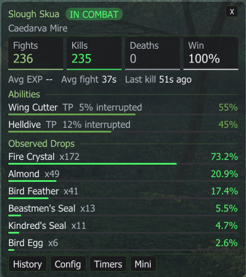
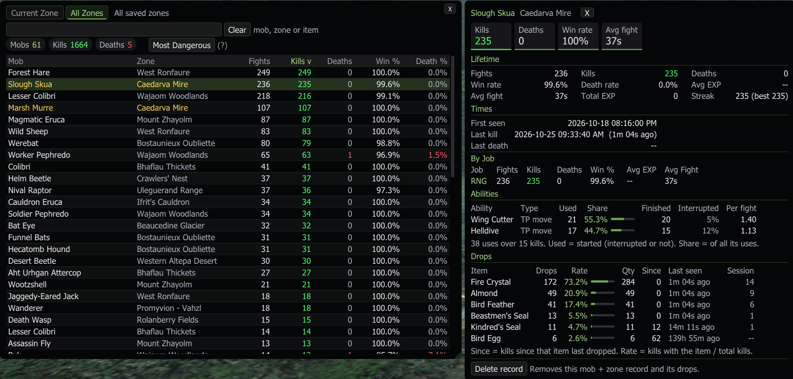
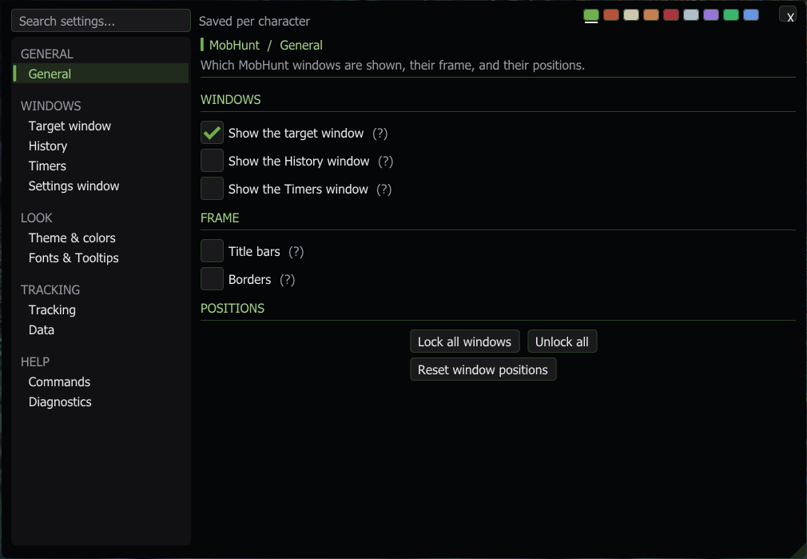

# MobHunt

**Version:** 1.7.2
**Platform:** Ashita v4 / HorizonXI
**Author:** Izumi (ShiroIzumi)

MobHunt keeps a lifetime record of every monster you fight, by **zone + mob name**: fights, kills, deaths, streaks, EXP, fight length, the abilities it uses and every drop you have seen from it. Target a mob and its record is right there.

> [!IMPORTANT]
> Written for **HorizonXI only**. It is not made for retail FFXI or other private servers, and I have no intention of troubleshooting or updating it for them.
>
> ⚠️ **NOT YET APPROVED ON HORIZONXI.** Check HorizonXI's addon rules before using it.

---

## Contents

- [Installation](#installation)
- [Commands](#commands)
- [What it counts](#what-it-counts)
- [The target window](#the-target-window)
- [History and Mob Details](#history-and-mob-details)
- [Timers](#timers)
- [Settings](#settings)
- [Privacy and rules](#privacy-and-rules)
- [Changelog](#changelog)

---

## Installation

1. Copy the `MobHunt` folder into your HorizonXI addons folder: `..\HorizonXI\Game\addons\`.
2. In game: `/addon load mobhunt`
3. To load it every time, add that line to your Ashita startup script (`scripts\default.txt`).

## Commands

`/mobhunt` and `/mhunt` work the same.

| Command | What it does |
|---|---|
| `/mhunt` | Open History and Settings (and turn the target window back on) |
| `/mhunt target` | Show / hide the target window |
| `/mhunt mini` | Switch the target window between Full and Mini |
| `/mhunt history` | Show / hide the History window |
| `/mhunt config` | Show / hide the settings |
| `/mhunt timers` | Show / hide the last-kill Timers for this zone |
| `/mhunt session` | Reset this session's numbers (lifetime records stay) |
| `/mhunt debug` | Debug messages in chat on / off |
| `/mhunt help` | List the commands in chat |

## What it counts

- **Fights:** a fight only begins once you engage or act on a mob, or the mob acts on you or your party. Targeting a mob, or just drawing your weapon, does not count. If someone outside your party claims it first, nothing is counted.
- **Kills:** your own kills, and kills by your party or alliance on a mob you took part in. Party kills you never touched can be counted too (on by default, can be turned off).
- **Deaths:** when the mob KOs you. A death ends the fight; fighting it again after a raise is a new fight.
- **Streaks, EXP and fight length:** current and best kill streak, average EXP per kill, and average fight time from the first action to the kill.
- **Per job:** every fight, kill, death, EXP and fight time is also filed under the main job you were on.
- **Drops:** read from the treasure pool, direct-to-inventory drops and the "You find ... on the ..." line, cross-checked so one drop is never counted twice. Drops from a different mob killed by your party are not credited to yours.
  - **Drop rate** = kills where the item dropped / total kills. Three Fire Crystals from one kill is one drop at 100%, with a quantity of 3.
- **Mob abilities:** every TP move and spell the mob **starts**, how many it **finished**, and how often it got interrupted (Stun, Silence, Paralyze, or the mob died first). They are only added to the record once the mob is dead; nothing is shown during the fight.
- **Session:** fights, kills, deaths, kills per hour and EXP since you logged in or reset the session.
- Players, party members, trusts and normal NPCs are never recorded as monsters.
- Reloading MobHunt in the middle of a fight does not count the fight twice.

## The target window

Shows the record of the monster you have targeted. It grows and shrinks with its contents, so you only set its width.

- **Full view:**
  - The mob's name with a pulsing **IN COMBAT** pill, and the zone.
  - Tiles for **Fights**, **Kills**, **Deaths** and **Win** rate.
  - Avg EXP, Avg fight and Last kill on one line.
  - **Abilities:** its most used TP moves and spells, each with its share and how often it gets interrupted.
  - **This Session:** your numbers for this mob since you logged in.
  - **Per-job stats**, once you have fought it on two or more jobs.
  - **Observed Drops:** every item with its count and drop-rate bar.
  - Buttons for History, Config, Timers and Mini.
- **Mini view:** a small window with the zone, a row of F / K / D / Win tiles, the last kill and session kills on one line, the best drop with its rate, and buttons for Full, History, Config and Timers. Full and Mini each remember their own place and width.

## History and Mob Details

- **History** lists every mob you have fought.
  - **Current Zone** / **All Zones** tabs. With All Zones, the mobs of the zone you are in are written in their own color.
  - **Search** by mob, zone or **item**: typing an item name (for example `Honey`) lists every mob that dropped it, with an extra column for the item's drop rate.
  - Totals as chips: Mobs, Kills, Deaths.
  - Click a column title to sort by it. **Most Dangerous** sorts by Death % (deaths per fight).
- **Mob Details:** click a mob in History to open it beside the list; click it again or the X to close it.
  - Tiles for Kills, Deaths, Win rate and Avg fight.
  - **Lifetime:** fights, kills, deaths, win and death rate, Avg EXP, Total EXP, Avg fight and streak (with best).
  - **Times:** first seen, last kill and last death.
  - **By Job:** fights, kills, deaths, win %, Avg EXP and Avg fight per job.
  - **Abilities:** each ability with its type, uses, share bar, finished, interrupted % and uses per fight.
  - **Drops:** drops, rate bar, quantity, **Since** (kills since that item last dropped), last seen and this session's count.
  - **Delete record:** removes this mob + zone record and its drops. Click twice.

## Timers

`/mhunt timers` or the Timers button: the time since your last kill of each mob in the current zone, most recent first, for placeholder and NM camps. Your current target is highlighted. Mobs show for up to 3 hours.

---

## Settings

Open them with `/mhunt config` or the Config button. A **search box** at the top finds any setting by name or help text, the pages are grouped in the sidebar, and the theme swatches at the top right switch the theme in one click. Hover any **(?)** for an explanation. Settings are saved per character, and the window opens on the last page you used.

### General → General
Which windows are shown, their frame and their positions.
- **Windows:** show the target, History and Timers windows.
- **Frame:** title bars on / off (without them, each window gets a small X), and borders.
- **Positions:** Lock all windows, Unlock all, and **Reset window positions** (click twice).

### Windows → Target window
- **Window:**
  - Show it, and only show it while you have a monster targeted.
  - **Mini view** on / off.
  - Lock position.
- **Look:** its own Size (85% to 200%) and, optionally, its own opacity.
- **Content:** turn on or off This session, Observed drops, Kills per hour, Per-job stats and Top abilities, and how many ability rows it lists.

### Windows → History
- **Window:** show it, lock position and size, and which tab it opens on (Current Zone or All Zones).
- **Look:** its own Size and opacity. Mob Details uses the same.
- **This zone:** highlight this zone's mobs in All Zones, and the highlight color.

### Windows → Timers
- **Window:** show it, and lock position.
- **Look:** its own Size and opacity.

### Windows → Settings window
- **Window:** lock position and size.
- **Look:** its own Size, and its own opacity, separate from every other window.

### Look → Theme & colors
- **Theme:** Forest, Rust, Bone, Copper, Gold, Garnet, Fuchsia, Silver, Amethyst, Emerald or Midnight. It colors the accents, tabs, borders and title bars.
- **Background:** use the theme's own background, or pick your own color, and the opacity of the target, History and Timers windows (unless one has its own opacity).
- **Stat colors:** Kills / good, Deaths / bad, and Muted text.

### Look → Fonts & Tooltips
- The Windows font every MobHunt window uses (Tahoma by default) and its text size. A new font needs a reload; the page has a button for it.
- How tooltips look.

### Tracking → Tracking
- **Fights:** the encounter timeout (a fight with no action for this long is dropped), and **Count party kills you did not join**.
- **Mob abilities:** track them on / off.
- **Debug:** debug messages in chat.

### Tracking → Data
- **Saved data:** how many records, kills and drop entries are saved, and where (`Game\config\addons\MobHunt\<Character>_<id>\settings.lua`).
- **Session:** reset this session.
- **Purge:** Purge drop data only (keeps fights, kills and deaths) or Purge all mob data. Both are red two-click buttons; settings, colors and window positions are kept.

### Help → Commands
- Every command, what dragging and clicking do, and the version.

### Help → Diagnostics
- Live counters: action packets, encounters started and resumed, kills, deaths and your HP.
- Drops: treasure packets, treasure-pool scans, inventory packets, direct-inventory drops, drops from find lines, drops counted and drops not credited.

---

## Privacy and rules

- MobHunt only reads what the game already shows you: action packets, defeat messages, the treasure pool, your inventory and chat lines.
- It never sends anything and never acts on its own.
- It never warns you when a mob starts an ability or spell. Abilities are only recorded once the mob is dead.
- Nothing in MobHunt's windows takes keyboard focus from TAB.
- Everything is saved per character in Ashita's `config` folder on your PC.

## Changelog

### 1.7.2 Eleven Themes
- **Gold** and **Fuchsia** themes: every Izumi addon (MobHunt, WhatsMyDamage, IzClock, ScrollingCombatLog) now has the same eleven themes in the same order.

### 1.7.1 New Mini View
- **The Mini target view is redesigned:** the zone under the name, then one row of tiles for **F**ights, **K**ills, **D**eaths and **Win** rate, each with its own colored strip (deaths only turn red when you have died).
- **One info line** with how long ago the last kill was, and your session kills and kills per hour when those are turned on.
- **Best drop:** when drops are shown, the mob's most common drop with its rate bar, and how many other drops it has.
- **Buttons:** Full, History, Config and Timers are now full-width buttons that light up while their window is open.
- README rewritten with screenshots.

### 1.7.0 New Settings Window
- **Settings window in the MogSuite layout:** a search box that finds any setting by name or help text, "Saved per character" and theme swatches at the top, and a sidebar grouped into **General**, **Windows** (Target window, History, Timers, Settings window), **Look** (Theme & colors, Fonts & Tooltips), **Tracking** (Tracking, Data) and **Help** (Commands, Diagnostics). Every page has a title, a line about what it is for, and its settings in two columns with (?) help. Every setting from before is kept.
- **Each window has its own look:** a Size (85% - 200%) and an optional Own opacity on its page, for the target window, History (with Mob Details), Timers and the settings window. The old shared Font Scale becomes each window's starting size, and History keeps its old own opacity.
- **All of MogSuite's themes:** Copper, Garnet, Silver, Amethyst, Emerald and Midnight join Forest, Rust and Bone (Midnight also tints buttons, title bars and popups). New **Use the theme's background** option (Look > Theme & colors).
- **The settings window has its own opacity** (Windows > Settings window), separate from the target, History and Timers windows.
- **Timers window lock** (Windows > Timers), **Lock all / Unlock all** and a two-click **Reset window positions** (General).
- The settings window remembers the last page you opened.
- **TAB no longer jumps into MobHunt's text fields** (the settings search box, History search): nothing in MobHunt's windows takes keyboard focus from TAB.

### 1.6.2 Interrupted % Fix
- Every ability read "100% interrupted": the finished moves were never counted (on HorizonXI the move id sits in the other half of the field MobHunt reads). Finishes are counted now.
- "Interrupted" = the mob started the move / spell but it never went off (Stun, Silence, Paralyze, a status that stops it, or the mob died first). It only uses fights from 1.6.2 on, so older counts don't show a wrong 100%: until new kills come in, no "interrupted" is shown (Mob Details shows -- for Finished / Interrupted). Uses and shares from before stay as they are.

### 1.6.1 Target Window Restyle
- The target window is cleaned up: Fights / Kills / Deaths / Win as tiles across the top, Avg EXP / Avg fight / Last kill on one line, then sections for **Abilities** (one per row with a share bar, TP or spell, and how often it gets interrupted), **This Session** and **Observed Drops** (one per row with a rate bar). Nothing runs out of the window any more.
- The "In combat" tag is a small pulsing pill next to the name. The per-job line is split in two so it fits.
- Config > Content > Rows: how many abilities the target window lists (default 4).

### 1.6.0 Mob Abilities, Look and Settings
- **Mob abilities:** every TP move and spell a mob **starts** is counted, even when it gets interrupted (hits, Stun, Silence, Paralyze), plus how many it **finished**. Nothing is shown during the fight: a fight's list is only added to the mob's record once the mob is dead. Mob Details has an **Abilities** table (uses, share of all its uses with a bar, finished, interrupted %, per fight); the target window shows the top three. Config > Content turns either off.
- **History / Mob Details opacity:** Config > Look > "History and Mob Details have their own opacity".
- **This zone's mobs:** with **All Zones** selected in History, the mobs of the zone you are in are written in their own color (Config > Look, on by default).
- **Nicer History and Mob Details:** totals as chips (Mobs, Kills, Deaths); Mob Details opens with stat tiles (Kills, Deaths, Win rate, Avg fight).
- **New Config window:** pages on the left (Windows, Look, Content, Tracking, Data, Fonts & Tooltips, Diagnostics) with a search box. Every setting is kept.
- **Font:** the windows use a Windows font (Tahoma by default). Config > Fonts & Tooltips picks the font, text size and the tooltip look (a new font needs a reload; the page has a button). Font Scale still sizes the windows on top.

### 1.5.3 Drop Tracking: Find Lines
- Drops are now also read from the "You find <item> on the <mob>." chat line, which appears after the drop for every item. The treasure-pool scan could miss an item when it landed in a pool slot that last held the same item (for example a second Beehive Chip).
- The chat line, the treasure pool and the inventory are cross-checked per kill, so one drop is never counted twice.
- Only kills you are credited for count (the mob name in the line must match a recent kill).
- The first time an item can't be matched from the treasure pool, MobHunt builds an item-name index once (a brief pause).

### 1.5.2 Target Window Toggle
- Closing the target window with X used to hide it for good (there was no way to bring it back). Now Config > Window has **Show Target Window**, `/mhunt target` toggles it, and bare `/mhunt` turns it back on along with History and Config.

### 1.5.1 Data Tab
- Config has a new **Data** tab: how many records, kills and drop entries are saved, and where (`Game\config\addons\MobHunt\<Character>_<id>\settings.lua`, one file per character).
- **Purge drop data only** clears every drop table and keeps fights / kills / deaths.
- **Purge all mob data** clears every mob record and the current session for a fresh start.
- Both are red two-click buttons: click once, then click again within 3 seconds to confirm. Settings and window positions are kept.

### 1.5.0 Mob Details, Item Search and Drop Fix
- **Drop tracking fixes.** A new drop of the same item into a reused treasure-pool slot was invisible (only the item id was compared); slots now also compare the drop time. Your own killing blow can no longer be mistaken for a party member's kill, which made MobHunt skip the drops of your kill.
- **Mob detail window.** Click a mob in History to open a window docked beside it: lifetime stats, times, this session, per-job stats and the full drop table. Click the mob again or the X to close it.
- **Drop table:** drops, rate with a small bar, quantity, **kills since that item last dropped**, last seen and this session's count. "Since" starts counting from the next drop for items recorded before 1.5.0.
- **Item search.** Typing an item name in the History search (e.g. `Honey`) lists every mob that dropped it, with an extra column showing the item and its drop rate (sortable).
- **History cleanup:** Current Zone / All Zones tabs, a summary line (mobs, kills, deaths), measured right-aligned number columns, clickable headers (Win % is now sortable), and a header row that stays put while the list scrolls.
- Fixed: with an empty search, Current Zone also listed mobs from other zones that had drops.
- Delete Record moved to the detail window, with a two-click confirm.

### 1.4.1 Timers Window Auto-Size
- The Timers window now sizes itself to the list (it stayed at its widest size before). Its close button sits right after the title when the title bar is hidden.

### 1.4.0 Per-Job Stats and Most Dangerous
- **Per-job stats:** every fight, kill, death, EXP and fight time is also filed under the main job you were on when the fight started. History detail shows a **By Job** table (fights, kills, deaths, win %, avg EXP, avg fight). The target window adds an "As BLU: ..." line once a mob has been fought on two or more jobs. Toggle: Config -> **Show Per-Job Stats**. Starts from this version (older fights have no job).
- **Most Dangerous:** History has a **Death %** column (deaths per fight) and a **Most Dangerous** button that sorts by it, highest first.

### 1.3.1 Timers Window Width Fix
- The Timers window no longer widens on its own (the close button sat past the window's content edge and the table stretched to the window width).

### 1.3.0 Timers, EXP per Kill, Fight Time
- Drawing your weapon no longer adds a fight. The mob is marked pending and the fight counts at the first real action between it and you / your party. If someone outside your party claims it first, nothing is counted.
- Each mob now shows **Avg EXP / Kill** (from the EXP you receive for its kills), **Avg Fight** (first action to kill) and **Last Kill** (time since). The session block also shows EXP earned from that mob.
- New **Timers** window (`/mhunt timers`, or the Timers button): time since the last kill of every mob in the current zone, most recent first, for placeholder / NM camps. Your current target is highlighted.
- EXP and fight-time averages start from this version; older kills have no data, so the averages show `--` until new kills are recorded.

### 1.2.0 Multi-Mob and Party Kill Fixes
- Fighting several mobs: a mob you stop hitting for a while (slept, bound, or waiting while you kill another) no longer times out while it is alive and claimed by you or your party. Before, its kill counted as a brand-new fight and the first fight was left unfinished.
- Party kills you never touched are now credited as a fight and a kill, with their drops. Applies when you get EXP for the kill, or when a party / alliance member gets the kill (or your party holds the claim). Turn it off with **Count party kills you did not join** in Config.

### 1.1.1 Target Window Width Fix
- Fixed the target / mini window widening forever while a mob was targeted. The auto-sized width was being saved back and fed into the next frame.
- Widths saved while the bug was active are reset to the default (410 full, 260 mini).

### 1.1.0 Suite Styling and Tracking Fixes
- Same black-base styling as the rest of the addon suite, with a **Theme** dropdown: **Forest** (default), **Rust**, **Bone**. Config uses flat styled tabs; History scope and window buttons show their on/off state. Kill / death / muted colors stay configurable; the old Accent color is now set by the theme.
- **Party drops:** when a party / alliance member kills a different mob after your kill, new treasure-pool items are no longer credited to your mob (prevents wrong drop rates in groups). Shown in diagnostics as ignored/unassociated.
- **Long party fights:** an open fight now stays alive while the mob is still in combat with anyone, so support jobs keep kill credit even if they only heal / buff for a while.
- **Saving:** lifetime statistics are written at most every 10 seconds during play (and on zoning / unload) instead of every 0.75 seconds, avoiding hitches as History grows. Window / option changes still save immediately.
- Target and zone-name lookups are done once per frame instead of repeatedly.

### 1.0.13 Opacity Slider
- A dedicated **Opacity** slider (0% to 100%) under Config -> Window -> Background / Opacity. It updates live while dragging, saves with the appearance settings, and works alongside the RGB background color.

### 1.0.12 Stat Layout Cleanup
- Fights, Kills and Deaths use three evenly spaced columns in the lifetime and session summaries.
- Streak and Best were removed from the visible summary; the streak data is still stored.

### 1.0.11 Drop Table Spacing
- Observed Drops gives longer item names more room: `Item` stretches, `Drops` and `Rate` have fixed widths. The Full target window's minimum width is slightly larger.

### 1.0.10 StatusTimers-Style Window Update
- Stock background changed to translucent black at about 45% opacity, rounded 7 px corners and tighter spacing. Custom backgrounds are kept; only the original stock background is migrated.
- **Automatic growth:** the Full and Mini target windows keep their width and size their height to the contents every frame, so new drop rows grow the window and fewer rows shrink it.
- Bare `/mhunt` (or `/mobhunt`) opens History and Config together. The other subcommands stay.

### 1.0.9
- Per-kill drop occurrences: multiple copies of the same item from one kill increase the quantity but count as one drop.
- Player deaths: HP-transition fallback with most-recent-hostile attribution, death deduplication, and the fight ends while you are dead. A KO clears active fights, and no new fight starts until your HP is above 0 again.

### 1.0.8 Death and Drop-Rate Corrections
- **Death tracking** uses several guarded signals: death messages from `0x029`, death message ids inside action packet `0x028`, and your HP going from above 0 to 0 as a HorizonXI fallback. The fallback credits the most recent hostile mob that acted on you, or the only active fight; with several mobs and no clear attacker it does not guess. Deaths are deduplicated across the signals.
- A death **ends the current fight**; re-engaging after a raise is a new fight.
- **Drop rate** = kills where the item appeared / total kills. Several copies from one kill are one occurrence with a larger quantity, so the rate can no longer show 300%.

### 1.0.7 Reload-Safe Encounters
- Reloading MobHunt during a fight no longer counts that fight a second time. A small active-fight marker (mob id, name, zone, record, start and last-activity time) is saved and restored after a reload while it is still fresh.
- Markers are removed when the mob dies, the fight expires, the record is deleted, or you zone.
- Session numbers start fresh after a reload; a restored fight counts once in the new session, so a kill right after a reload can't show `Fights: 0 / Kills: 1`.

### 1.0.6 Drop Tracking Fix
- HorizonXI's `0x0D2` layout does not match the retail layout (it produced item id `0`), so it is no longer trusted for the item. Treasure-pool loot is read from Ashita's live treasure-pool memory instead, watching the ten pool slots for new items.
- Items already in the pool when the addon loads are not credited to a new kill. New pool items go to the most recent recorded kill within a short window, and that kill is marked so a later inventory award is not counted again. `0x0D2` stays as a debug signal.

### 1.0.5
- Fixed a crash on inventory packets `0x01E` / `0x01F` from uninitialized diagnostic counters, and hardened every counter against nil values.

### 1.0.4 Drop Tracking Fix
- Handles both loot paths: `0x0D2` treasure-pool items, and direct-to-inventory items (`0x01F` / `0x01E`, including stack increases). The inventory fallback is only active for a very short window after a recorded kill that produced no treasure-pool packet, so normal inventory changes and later pool awards are not counted.
- Diagnostics show treasure packets, inventory packets and direct-inventory drops separately.

### 1.0.3
- **Current Zone** and **All** scope buttons in History; the choice is saved.

### 1.0.2
- **Delete Record** for the selected History entry, with a confirmation step.
- Fixed treasure going uncredited when `0x0D2` arrives after the mob despawned; treasure now uses the known fight / recent-death record. The recent-death window is 30 seconds.
- Diagnostics for treasure packets seen, drops counted and drops ignored. `/mhunt debug` prints the parsed treasure packet. Item id `65535` is labeled **Gil**.

### 1.0.1
- Players, party and alliance members are no longer treated as monsters (entity spawn flags are checked first).
- **Mini target window**, with its own saved position and size, Mini / Full buttons, `/mhunt mini` and a Config toggle.

### 1.0.0
- First release: lifetime fights, kills, deaths and drops by zone + mob name, session stats, a searchable History window, and a configurable target window.
