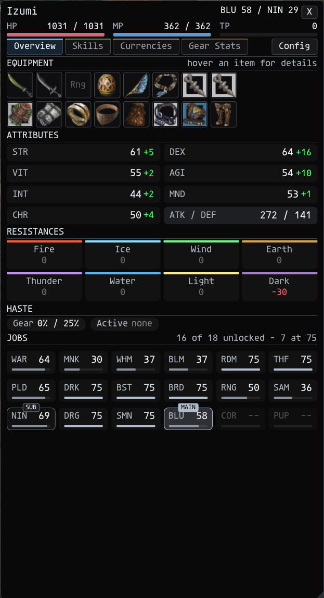
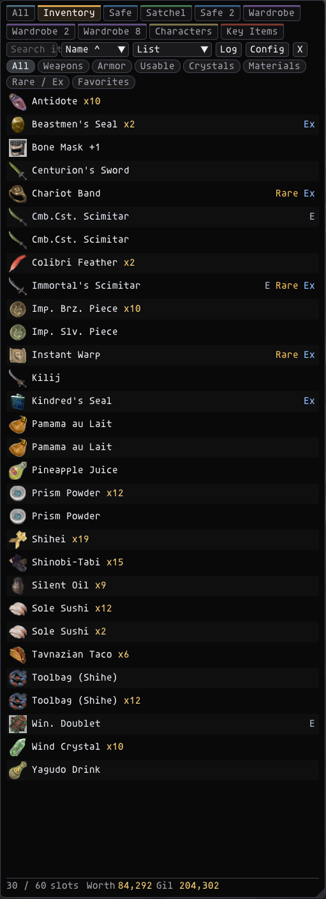
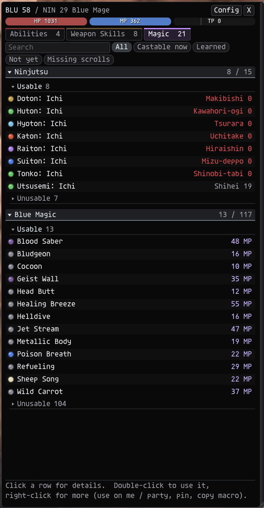
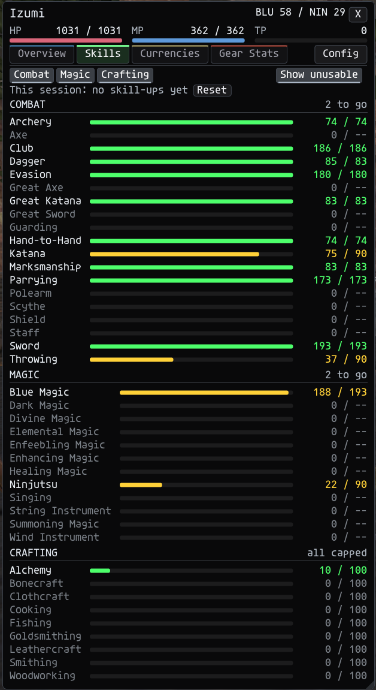
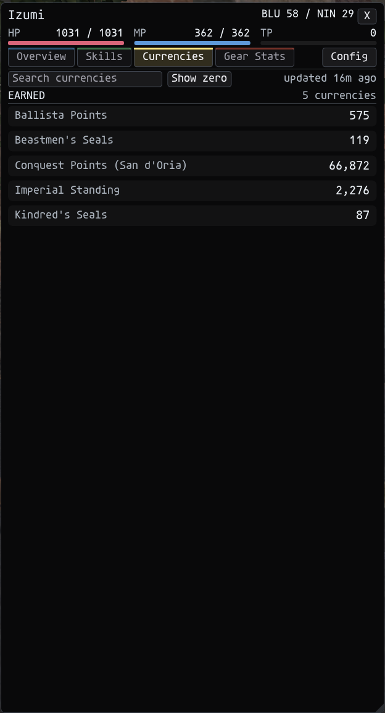
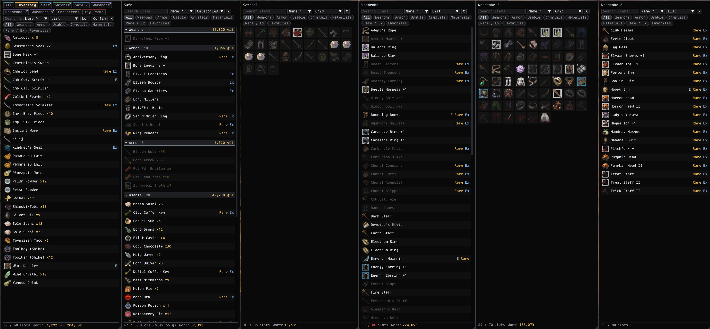
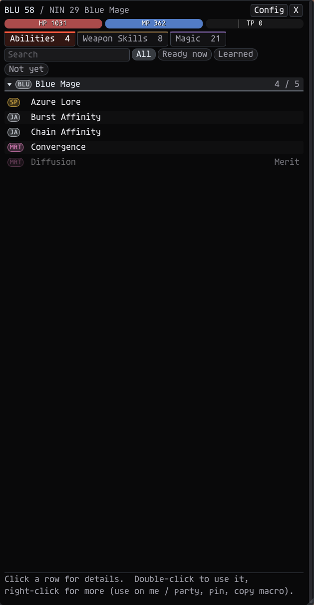
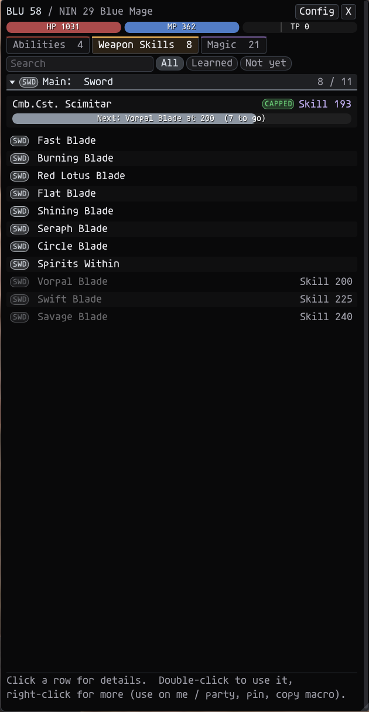
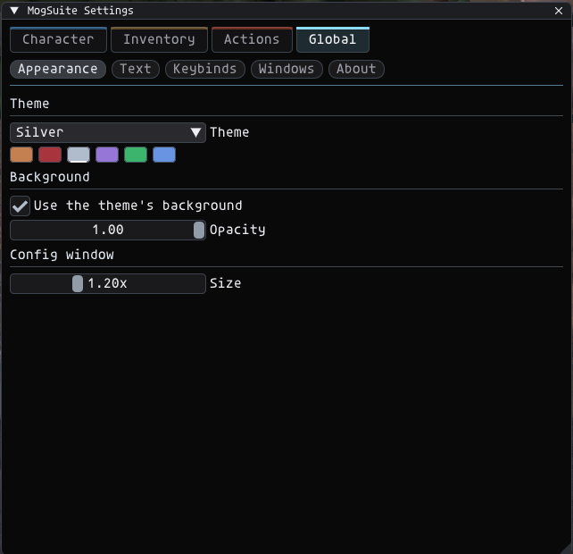
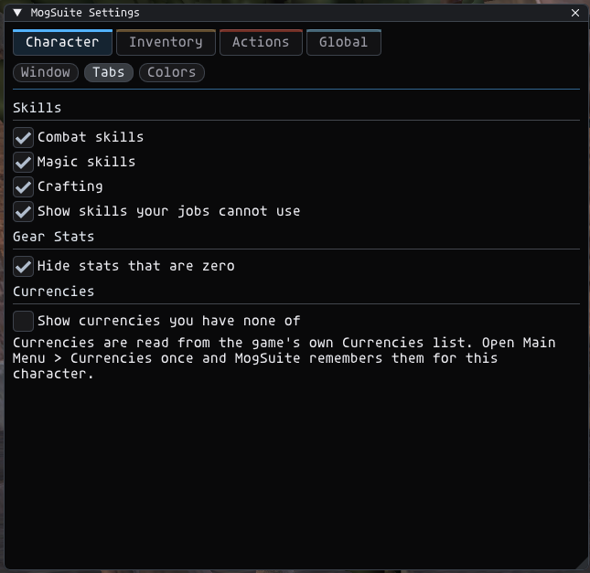

# MogSuite

**MogSuite** is an Ashita v4 addon for **HorizonXI** that puts your character, your bags and everything you can do into three clean, themed windows, with one settings window for all of them.

| Window | Key | What it shows |
|---|---|---|
| **Character** | `C` | Equipment, attributes, resistances, haste, jobs, skills, currencies and gear stats |
| **Inventory** | `B` | Every bag in tabs, key items, item values, a loot log and your other characters' bags |
| **Actions** | `P` | Abilities, weapon skills, magic, pets and blood pacts, with recast timers |
| **Requests** | | A popup when someone invites you to a party / alliance or wants to trade |
| **Calendar** | `L` | Vana'diel days and moon on a calendar, conquest, your timers and events, ships and guilds |
| **Crafting** | `J` | Crafting skills, recipes, what you can make from your bags, and your own HQ / break rates |

**Version:** 1.6.7
**Authors:** Izumi (ShiroIzumi) / Kyrias (.kyri)

<table>
  <tr>
    <th>Character</th>
    <th>Inventory</th>
    <th>Actions</th>
  </tr>
  <tr>
    <td></td>
    <td></td>
    <td></td>
  </tr>
</table>

---

## Installation

1. Copy the `MogSuite` folder into `C:\HorizonXI\HorizonXI\Game\addons\`.
2. In game: `/addon load mogsuite`
3. Press **C**, **B** or **P**, or type `/ms` for the settings.

To load it every time, add `/addon load mogsuite` to your Ashita startup script (`scripts\default.txt`).

## Commands

`/ms`, `/mog` and `/mogsuite` all work the same.

| Command | What it does |
|---|---|
| `/ms` | Open / close the settings window |
| `/ms char` | Open / close the Character window |
| `/ms inv` | Open / close the Inventory window |
| `/ms act` | Open / close the Actions window |
| `/ms cal` | Open / close the Calendar window |
| `/ms craft` | Open / close the Crafting window |
| `/ms reset` | Move every window back to its default place |
| `/ms test party` | Show a test request popup (`party`, `alliance` or `trade`) |
| `/ms help` | List the commands in chat |

The open keys do nothing while the chat box is open or you are typing in a text box. Change them in **Settings > Global > Keybinds**.

## Nothing is done for you

MogSuite never uses anything on its own. Items, abilities, weapon skills and spells are only used when you click them, the same as a macro would. It only shows information after the game has sent it to you.

---

## Character

- **Header:** your name, jobs and levels (and your base level when you are level synced), with HP / MP / TP bars.
- **Overview:** your equipped items as icons (hover for the item description), attributes with gear bonuses, ATK / DEF, resistances, gear and active haste, and every job's level.
- **Skills:** combat, magic and crafting skills in alphabetical order, each with a bar toward its cap for your jobs and level. Skill-ups gained this session show next to the skill.
- **Currencies:** conquest points, seals, crests, guild points, Imperial Standing and more. The ones you have come first, then the ones at zero, each alphabetical, with a search box. Open **Main Menu > Currencies** in game once to load them; MogSuite remembers them for that character. The game only sends this list when you open that menu, so open it again to refresh.
<table>
  <tr>
    <th>Skills</th>
    <th>Currencies</th>
  </tr>
  <tr>
    <td> Skills: combat, magic and crafting skills with caps"></td>
    <td> Currencies: what you have earned"></td>
  </tr>
</table>

- **Gear Stats:** accuracy, attack, haste, Store TP, Fast Cast, Cure Potency and more, totaled from your equipped gear's descriptions. Pet, latent, set and enchantment lines are not counted as your own stats.

## Inventory

- **Bag tabs:** All, Inventory, Safe, Satchel, Safe 2, Wardrobes 1-8, Storage, Locker, Sack, Case, then **Characters** and **Key Items**. Bags you don't have are not shown. Tabs of the same kind share a color.
- **Views:** List (icon, name, quantity and E / Rare / Ex tags), Grid (icons with the quantity in the corner) and Categories (Favorites, New, Equipped, Weapons, Armor, Ammo, Usable, Crystals, Rare / Ex, Materials, in your order).
- **Pop-out windows:** **Shift+Click** any tab to open it in its own window, with its own size, view, sort and search. Shift+Click it again to close it.
- **Search, sort and filter:** sort by slot, name, type, quantity or newest; filter by Weapons, Armor, Usable, Crystals, Materials, Rare / Ex or Favorites.
- **Item values:** what an NPC vendor pays, per item and for a full stack, plus the item's Auction House category. A price list for every item is built in. When a shop appraises an item, MogSuite saves the exact price HorizonXI gave you and uses it from then on.
- **Favorites:** right-click > Add to favorites. They get a star, can sit at the top, and can't be dropped.
- **New items** are highlighted until you hover them or close the window. Zoning does not count as new.
- **Right-click menu:** Use, Equip (with the slot for rings and earrings), Drop (with a quantity slider; Rare / Ex items need a second click) and Favorite.
- **Key Items:** every key item you have, read from the game's own key item list. Temporary ones get a **TEMP** tag; right-click to change that.
- **Characters:** the last known bags of every character you have logged in with MogSuite, so you can find which mule has what.
- **Mog House storage:** Safe, Storage and Locker are saved when the game loads them and can be viewed anywhere (marked as a snapshot).
- **Loot log (Log button):** everything you gained this session, gil gained per hour and today, and the value of your loot.
- **Inventory full warning:** a banner at the top of the screen when an item comes in and you are almost full.


*The Inventory with five bags popped out (Shift+Click a tab), each with its own view: Categories, Grid and List.*

## Actions

- **Header:** your jobs and HP / MP / TP bars (the TP bar has a mark at 1000).
- **Tabs:** Abilities, Weapon Skills, Magic, and a pet tab for each pet job you are: **Summons** (SMN), **Wyvern** (DRG, main job only), **Automaton** (PUP) and **Beast** (BST).
- **Search and filters:** Ready now / Castable now, Learned, Not yet, and Missing scrolls on Magic.
- **Recast timers** on every row, and a **details pane** with the description, costs, cast and recast time, target and the macro line (Copy / Use / Pin).
- **Pinned actions:** right-click > Pin to the top. Click a pinned action to use it.
- **Abilities:** main job (two-hour first, then by level), pet commands and support job abilities, with badges (SP, JA, PET, ROLL, QD, MAN, MRT).
- **Weapon Skills:** for your main and ranged weapon, with your skill level, a CAPPED tag, and a bar to the next weapon skill.
- **Magic:** every spell your jobs can use, by school, split into Usable and Unusable, with element, MP cost and the scrolls you are still missing. Blue Magic shows the spells you have set. Ninjutsu shows your tool counts.
- **Pets:** your pet's HP / MP / TP while it is out, its commands, and for Summoner every blood pact (Rage / Ward) of the avatar that is out.
- **Using:** double-click a row, click a pinned action, or right-click for Use on me / a party member / a selected enemy.

<table>
  <tr>
    <th>Abilities</th>
    <th>Weapon Skills</th>
  </tr>
  <tr>
    <td> Abilities with badges and merit abilities"></td>
    <td> Weapon Skills with the weapon card and next weapon skill"></td>
  </tr>
</table>

## Requests

- **Party and alliance invites:** "*Name* is inviting you to join the party." (or *the alliance*) with **Join** and **Decline** buttons. They send `/join` and `/decline`, the same as typing them.
- **Trade requests:** "*Name* wants to trade with you." with **Accept Trade** (opens the trade window) and **Decline**.
- Nothing is answered for you: only your click sends anything.
- The popup closes by itself when you answer from the game's own menu or chat, when the trade window opens, and after 60 seconds without an answer (you can change or turn that off). It shows how long it has left.
- The first time, it shows in the middle of your screen; after that it stays where you put it. Use `/ms test party`, `/ms test alliance` or `/ms test trade` (or the Test buttons in Settings) to place and size it. Test popups only close when you click their buttons.

---

## Calendar

`L` or `/ms cal`. Everything is worked out from your computer's clock (nothing is read from the server).

- **Today:** the Vana'diel time, day and element, the moon (picture and %), what's coming up (conquest results, your events, timers getting ready), the next 8 Vana'diel days with the Earth time each starts, crafting guilds (open / closed / holiday) and the next ships.
- **Vana'diel:** a month of Vana'diel days, one column per weekday, with the moon on each day, full / new moons, guild holidays (a dot) and the Earth time each day starts. Hover a day for the details.
- **Earth:** your month: events, timers getting ready, conquest results, full / new moons. Click a day to see it and add an event.
- **Timers:** cooldowns you start yourself. Ready-made ones: Dynamis (72 h), Limbus / Cosmo-Cleanse (72 h), ENM key item, BCNM orb, weekly, daily, custom. Click Start when you do the thing; change the name or hours any time. Per character.
- **Events:** your own events (once, daily, weekly or monthly) with a note and a color, shared by all your characters (kept in `config\addons\mogsuite\calendar_events.lua`).
- **Travel:** every airship, the ferry, the manaclipper and the barge, and the crafting guild hours.
- **Login summary:** a few seconds after you log in, a small popup (and / or chat lines): the day, the moon, conquest results, timers that are ready, today's events, guild holidays.
- **Notices:** a timer is ready, an event is about to start (15 minutes before by default) or starting: chat, popup and an optional sound (`sounds\notice.wav`).
- **Conquest results:** Sunday 11:00 AM by default (HorizonXI, Eastern time); set the day and time in Calendar > Conquest if your computer is in another time zone.

## Crafting

`J` or `/ms craft`.

- **Skills:** each craft's level, how many recipes you can do and how many are good for skill-ups (up to 10 levels over your skill). Click a craft for its recipes.
- **Recipes:** every Horizon-era recipe (2,500+, from LandSandBoat). Search by result or material, pick a craft, and filter to your skill, to recipes you have every material for, or show desynthesis too. The right side shows the crystal and materials with how many you have (every bag; hover for where), the HQ results, and your own synth rates.
- **Can make:** recipes you have every material for right now, closest to your skill first.
- **Ledger:** every synth you make is counted per recipe (NQ / HQ1 / HQ2 / HQ3 / break) with the Vana'diel day, the moon and the way you were facing, for your own HQ and break rates. All characters, kept in `config\addons\mogsuite\synth_ledger.lua`.

## Settings (`/ms`)

One window for the whole suite:

- **Search:** type in the box at the top and every matching setting, in every module, shows right away, grouped by page. It searches each setting's name and its help text, so "color", "lock", "size" or "key" all find what you want.
- **Sidebar:** one group per module, in its own color, plus **Global**.
  - Click a page to open it.
  - The dot next to a module's name shows whether its window is open. Click the dot to open or close that window.
- **Pages:** each page starts with one line about what it is for.
  - Options that only matter when another one is on sit indented under it.
  - Hover the **(?)** after a setting for what it does.
  - Buttons that can't be undone, like forgetting learned prices or clearing pins, need two clicks.
- **Theme swatches** in the top-right corner switch the theme instantly.
- The window remembers where you put it, its size and the last page you had open.

| Group | Pages |
|---|---|
| **Character** | Window (lock, border, title bar, UI scale), Tabs (which skills to show, zero stats, zero currencies), Colors (with a preview) |
| **Inventory** | Window (view, sizes, tags), Items (quantity format, favorites, full-inventory warning, new items), Colors, Value (price list, learned prices), Categories (section order), Bags (hide tabs) |
| **Actions** | Window (size, rows, bars, pins, details pane), Lists (support abilities, job traits, HorizonXI "H" marks, relic weapon skills, spells, sorting), Colors |
| **Requests** | Popups: which requests, auto-close time, size, lock, title bar, border, center on screen, test popups |
| **Global** | Appearance (theme, background, opacity, settings window size, mouse pointer), Text effect, Keybinds (including Esc closes all windows), Windows (open, lock all, reset all), About |

<table>
  <tr>
    <th>Global</th>
    <th>Character</th>
  </tr>
  <tr>
    <td> Global > Appearance: theme, background and opacity"></td>
    <td> Character > Tabs"></td>
  </tr>
</table>

Themes: **Copper**, **Garnet**, **Silver** (default), **Amethyst**, **Emerald** and **Midnight**.

**Mouse pointer:** FFXI hides the Windows mouse pointer, so MogSuite draws its own while the mouse is over any MogSuite window (including dropdowns and popups). By default it is a bright fuchsia arrow at 1.4x size. Change the size, fill color, outline color and shadow, or turn it off (for example if you use YoloMouse), in **Settings > Global > Appearance > Mouse pointer**.

Settings are saved per character. Your characters' bags, learned vendor prices and key item marks are shared by all your characters, in `addons\MogSuite\data\`.

## Files

```
MogSuite/
  mogsuite.lua          entry point: settings, commands, keys, events
  core/                 theme, keys, module loader, the settings window, the mouse pointer
  modules/character/    the Character window
  modules/inventory/    the Inventory window
  modules/actions/      the Actions window
  modules/requests/     the party / alliance invite and trade request popup
  data/                 shared data (bags, learned prices, key item marks, built-in price list)
  screenshots/          the pictures in this README
```

Each module folder has an `init.lua` (how the suite talks to it), a `config.lua` (its settings pages) and a `defaults.lua` (its default settings). The files of one module share one module scope, so they can use each other's functions; modules are separate from each other.

**Writing a module:** besides the usual `module_*` functions:

- Every module with a window should define `module_close_all()`, which closes all of its windows. The Esc key calls it on every module (and closes the settings window), so new modules get Esc-to-close for free.
- Define `module_is_open()` so the sidebar dot shows whether the window is open.
- Settings pages:
  - `module_config_sections` is a list of `{ key, label, desc, draw }`.
  - `module_config_dirty` is how the module saves a change.
  - Build the pages with the `ui` widgets (`ui.section`, `ui.check`, `ui.slider_f` / `ui.slider_i`, `ui.color`, `ui.choice`, `ui.button`, `ui.danger`, `ui.info`, `ui.block`, `ui.sub`; see `core/cfgui.lua`) so the search box finds every setting.

## Credits

- Item sell prices and Auction House categories come from [LandSandBoat](https://github.com/LandSandBoat/server)'s `sql/item_basic.sql`. Put a newer `item_basic.sql` in the MogSuite folder and press **Reload price list** (Settings > Inventory > Value) to use it instead.
- Made for the HorizonXI community.

## Changelog

### 1.6.7
- Character, changing gear: "worn" marks only the item you actually have on. With two identical items (two Warp Cudgels) both showed as worn.

### 1.6.6
- Character, changing gear: items with charges (Warp Cudgel, Chariot Band ...) show them like the Inventory does, " (2/3)" in blue, plus the time until they can be used again; the tooltip says it too.
- When you carry two items with the same name, double-click equips the exact one you clicked (it used to take whichever the game found first).

### 1.6.5
- Calendar: the login summary and notice popup can be dragged anywhere, and remembers where you put it (Settings > Calendar > Login summary > **Reset popup position** puts it back). It stays open while the mouse is over it.

### 1.6.4
- **Calendar, a fresh look:**
  - **Today:** the header is a panel tinted with the day's element, with a bar showing how far into the day it is, the element it beats in its own color, and a bigger moon. Each section has a colored header; rows are striped; guilds show in their craft's color with open / closed / holiday tags; timers and ships show small progress bars; the next days show their moon.
  - **Vana'diel:** more room inside each day box, a colored edge on each day, a glow around today, and the line at the bottom no longer runs over the boxes.
  - **Timers:** each timer is its own card with a colored edge (ready / counting / not started). The hours box has its own - and + buttons and no longer covers the number. The Add buttons are colored, one color per kind, and wrap on narrow windows.
  - **Travel:** each kind of ship has its own color, with a short note. Every route shows a boarding / at sea tag and a bar for where the ship is in its run, and times turn yellow or red when it is about to dock or leave. Guilds show in their craft's color, with their hours and their day off in that day's color.

### 1.6.3
- Crafting: the craft drop-down has a fixed width, so My skill / Have materials / Desynth stay in the window.

### 1.6.2
- **Crafting, "just tell me what to do":**
  - **Tips** (each recipe): your odds right now (break %, HQ % with HQ2 / HQ3), or "you are N under it", and how many levels until better HQ odds; whether it is good for skill-ups ("Good for skill-ups", "Too easy", "Too hard"); and its guild, open now or when it opens (and its holiday). The odds follow the server's own synthesis rules (LandSandBoat).
  - **Missing materials:** "Make it" (opens the recipe that makes it) and where it drops.
  - **Make x N:** what you still need for N synths, after what you own in every bag.
  - **Skills tab, Next:** the best recipes to skill up on for each craft: ones you can make now first, then the fewest missing materials. Click one to open it.

### 1.6.1
- The inventory window stays on the tab you picked when you warp or zone (it used to jump to Safe while your bags reloaded).

### 1.6.0
- **Calendar** module (`L`): Today, a Vana'diel month, an Earth month, timers, your events, travel; a login summary and notices.
- **Crafting** module (`J`): skills, recipes with materials you own and HQ results, what you can make, and a synthesis ledger with your own HQ / break rates.
- **Keys win over the game:** a MogSuite key (C, B, P, L, J or your own) no longer also does its game action (the key is taken out of the game's keyboard input while it opens a MogSuite window; never while you type).

### 1.5.3
- **Stacks window** (the Stacks button next to Log on the inventory window) lists the items you could stack together, across every bag of every character MogSuite has seen.
  - For each item it shows where the copies are, which spot to keep them in (the one with the most), and what to move there. It also shows how many slots that frees.
  - Full stacks stay put. Moves to another character are marked "trade / delivery box". Ex and Rare items are only combined within one character.
  - Options: All characters / This character, sort by most saved or by name, a search box, and Spread (also items in several places with no slot saved).
  - Suggestions only: nothing is moved for you.
- **Progress > Access:**
  - It lists only the key items **this character** has. They're read from the game's key item list after you log in or zone, so another character's key items never show.
  - The rest are in a "Not yet" line (hover it to see them).
- **Fame auto-fill fixed:** MogSuite read the zone number where the event number is, so it never matched. Talking to the fame NPC now fills in the level.
- **Inventory:**
  - Key items are filed under the character who logged in (no mix-up when you switch characters).
  - A bag you emptied is saved as empty, so other characters' views don't show stale items.

### 1.5.2
- **Death Recap** no longer pops up when you zone (HP reads 0 while loading); it only opens on a real death.
- **Fame fills in by itself** when you talk to an area's fame NPC (Namonutice, Flaco, Zabirego-Hajigo, Mendi, Waylea, Vaultimand). San d'Oria and Jeuno also show your fame points in the tooltip. You can still set it by hand.

### 1.5.1
- **Actions:** details now show as a hover tooltip (styled by Fonts & Tooltips) instead of the pane at the bottom. The pane is still in Settings > Actions > Window.
- **Gear panel:** search box over names, descriptions and stats. `dex & str` = items with both, `dex | agi` = items with either (they can be mixed).
- **Gear panel:** Usable / Usable later / Unusable sections collapse with a click and stay that way after a reload.
- **Config buttons** toggle: clicking a window's Config again closes the settings window.

### 1.5.0
- **Fonts & Tooltips** (Settings > Global): use a Windows font (Tahoma by default) instead of Ashita's pixel font, so text stays smooth at any size and on 4K. Pick the text size, override the text and label colors, and style every tooltip (font, size, width, padding, border, colors) with a live preview. A new font needs a reload; the page has a button for it.
- **Character: gear panel.** Double-click a slot on the equipment strip (or right-click > Change) and a panel opens beside the Character window with every item for that slot in your Inventory and Wardrobes: Usable, Usable later (level too low, level sync counts) and Unusable (wrong job or race), with the reason, icon, level and stats. Double-click (or right-click > Equip) sends the game's `/equip`. Right-click a slot > Remove unequips it.
- **Character: Upgrade finder.** Items are scored with a stat priority per job (editable in Settings > Character > Gear & Upgrades). Better items get "^ upgrade", the best one "* best".
- **Character: Death Recap.** The last actions done to you (hits, misses, shadows, heals, status effects; how many is up to you, 1-50) freeze when you die and pop up. Recap button next to Config.
- **Character: Progress tab.** Nation and rank, current Nation / Zilart / Promathia / Aht Urhgan missions, fame per area (set it after asking that area's fame NPC; the tab tells you who and where) and access key items.
- **Character: Conquest tab.** Region owners, your nation's standing, days to the next tally, conquest points and this region's influence.
- **Inventory: compact header.** Two rows: your pinned bags plus a Bags menu (grouped Carried / Wardrobes / Mog House / Other, with Pin / Unpin), then search, sort, view and a Filter menu. Shift+Click still opens pop-outs. The old header is one checkbox away (Settings > Inventory > Window).
- **Inventory: tooltips plus.** Where an item drops (mobdb), what it is made with and which recipes use it (Horizon-era crafts), and how many you have in other bags.
- **Inventory: new views.** Usable (food, medicines, scrolls, ninja tools, ammo), Cleanup (suggestions only: stacks to merge, items spread over bags, NPC-only sell items, outgrown gear) and Upgrades (per slot, from the Upgrade finder).
- **Inventory: Watch list.** Right-click > Watch this item, set how few is "running low"; an alert window (and an optional sound) tells you. Alerts every time it drops or once per login.
- **Actions: tooltips** show range and area of effect, and weapon skills show their skillchain properties, magic burst elements and which of your other weapon skills they open into or close after. A **Skillchains** section at the bottom of the Weapon Skills tab lists every chain your ready weapon skills make.

### 1.4.0
- **New settings window:** a search box that finds any setting in any module, and a sidebar with each module in its own color. A dot next to each module's name shows whether its window is open; click it to open or close the window.
- Each page starts with a line about what it is for. Settings line up in two columns, with a **(?)** for help. Dependent options sit indented under the one they depend on.
- New previews for the Character colors, the Inventory colors (with gil) and the text effect (light and dark backgrounds).
- Two-click confirm on Forget learned prices, Clear pinned actions and Reset all positions.
- Theme swatches in the top-right corner of the settings window.
- The settings window remembers the last page you had open, and the window is a little wider to fit the sidebar.

### 1.3.0
- **Esc closes MogSuite windows:** pressing Esc closes every open MogSuite window (Character, Inventory and its pop-outs, Actions, the settings window and a Requests popup). The game still gets Esc, so its own menus close as usual. Ignored while you're typing. Turn it off in Settings > Global > Keybinds.
- **Inventory: use equipped gear with charges.** Gear like Chariot Band or Warp Cudgel gets a **Use** option on right-click once it's equipped, showing charges left and time until it's ready (greyed out until then). Equipped usable gear that sits in a Mog Wardrobe also shows in the Inventory tab, in blue, so you can use it from there. Every copy of an enchanted item (worn or not) shows its charges after the name, like `Warp Cudgel (19/30)`, and a countdown while it can't be used yet (for example right after you equip it); the countdown goes away once it's usable.
- **Actions: HorizonXI data.** Job abilities, Phantom Roll levels, blood pacts and weapon skill levels now follow the HorizonXI wiki (for example Velocity Shot at 45, Retaliation at 50, Focus at 15, Starlight at skill 40, Corsair's Roll at 75). Abilities HorizonXI doesn't have are gone, and mythic weapon skills are no longer listed.
- **Actions: job traits.** Your main and support job traits are listed (HorizonXI levels) after the abilities.
- **Actions: "H" marks.** Anything HorizonXI changed has a small gold **H**; hover it to see what changed.

### 1.2.1
- Actions: **Starlight** and **Moonlight** are now used on yourself (`<me>`) instead of your target.

### 1.2.0
- Visible **mouse pointer** over every MogSuite window, dropdown and popup (FFXI hides the Windows one). Default: fuchsia, 1.4x. Size, colors, shadow and on / off in Settings > Global > Appearance.

### 1.1.0
- New **Requests** popup (was the separate Accept addon): party and alliance invites and trade requests, with the inviter's name, Join / Accept and Decline buttons, auto-close, and a Requests tab in Settings.

### 1.0.0
- First release: Character, Inventory and Actions in one suite, with one settings window, six themes, colored tabs and an open key for each window.
