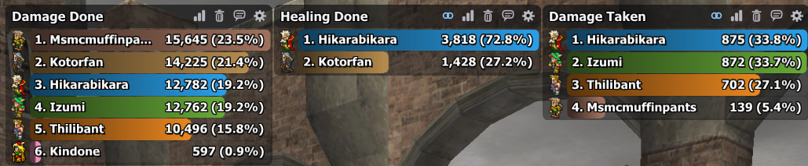
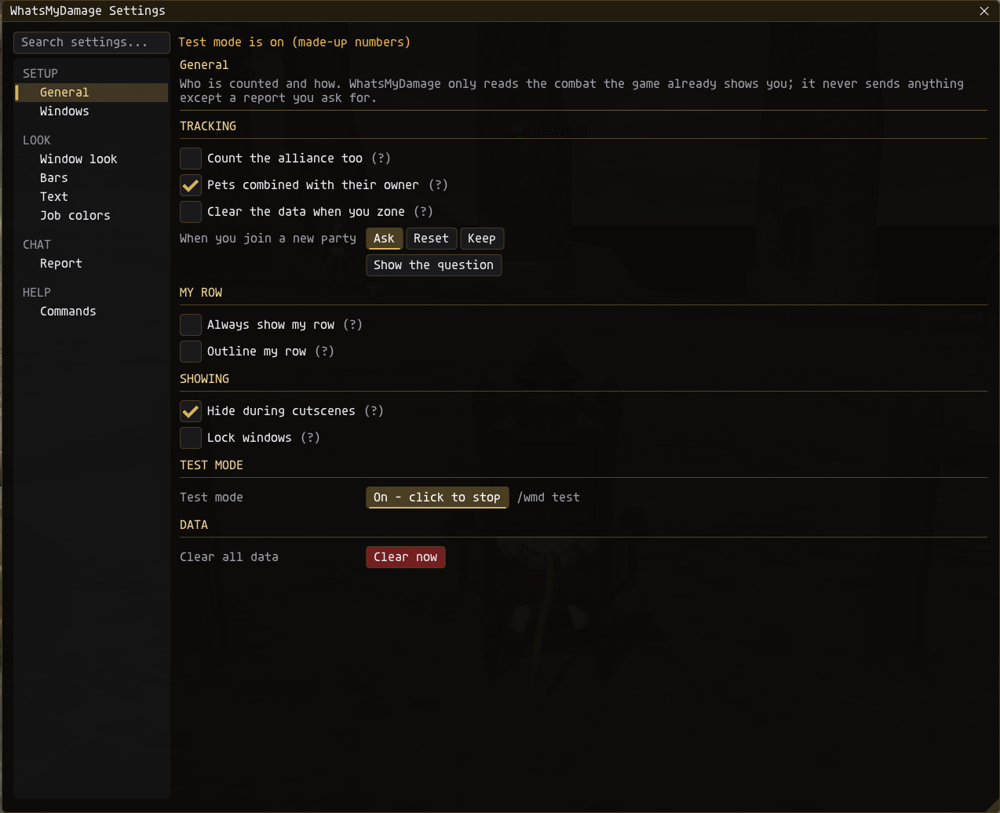

# WhatsMyDamage (WMD)

**Version:** 1.1.0
**Platform:** Ashita v4 / HorizonXI
**Author:** Izumi (ShiroIzumi)

A damage meter in the style of WoW's **Details!**: colored bars with `1. Name` on the left and `amount (share%)` on the right. Up to three windows show **Damage Done**, **Healing Done** and **Damage Taken** for you, your party, or the whole alliance.

> [!IMPORTANT]
> Written for **HorizonXI only**. It is not made for retail FFXI or other private servers, and I have no intention of troubleshooting or updating it for them.
>
> ⚠️ **NOT YET APPROVED ON HORIZONXI.** Check HorizonXI's addon rules before using it.

---

## Contents

- [Installation](#installation)
- [Commands](#commands)
- [What it counts](#what-it-counts)
- [The meter windows](#the-meter-windows)
- [Hover and details](#hover-and-details)
- [Reporting to chat](#reporting-to-chat)
- [Settings](#settings)
- [Privacy and rules](#privacy-and-rules)
- [Changelog](#changelog)

---

## Installation

1. Copy the `WhatsMyDamage` folder into your HorizonXI addons folder: `..\HorizonXI\Game\addons\`.
2. In game: `/addon load whatsmydamage`
3. To load it every time, add that line to your Ashita startup script (`scripts\default.txt`).

Job icons come from **XIUI** (`addons\XIUI\assets\jobs`). Without XIUI, choose the Letters icon set.

## Commands

`/wmd` and `/whatsmydamage` work the same.

| Command | What it does |
|---|---|
| `/wmd` | Show / hide the meters |
| `/wmd config` | Open the settings (or the gear icon, or right-click a meter) |
| `/wmd reset` | Clear all data |
| `/wmd test` | Test mode on / off: a made-up party that keeps fighting |
| `/wmd report [damage\|heal\|taken] [p\|l\|l2\|s\|echo]` | Open the report window, or send right away when a channel is given |
| `/wmd details` | Open the details window |
| `/wmd window <1-3> [on\|off]` | Show / hide one window |
| `/wmd mode <1-3> <damage\|heal\|taken>` | Choose what a window shows |
| `/wmd stack` / `/wmd unsnap` | Snap the windows under each other / pull them apart |
| `/wmd lock` | Lock / unlock moving |
| `/wmd resetpos` | Put the windows back in their default place |
| `/wmd help` | List the commands in chat |

## What it counts

- **Damage Done**, **Healing Done** and **Damage Taken**, for you (solo too), your party, and the alliance when that option is on.
- Damage only counts when it lands on monsters.
- Pets can be added to their owner's bar or shown on their own. Combined pets are still listed separately in the hover and details windows.
- One running total, with no fight segments. **Reset** clears it, or turn on "Clear the data when you zone".
- **New party:** when you join a new party and the meters already have numbers, a small window asks whether to reset them. Joining a party after being on your own counts, and so does moving to a different party. Someone joining your current party does not.

## The meter windows

- **Move:** drag a window by its header.
- **Snap:** drop one window next to another and they snap together; a glowing line shows where. Snapped windows move as one. **Ctrl + drag**, or the chain icon, pulls one out.
- **Width:** drag the bottom-right corner. Stacked windows can share one width.
- **Header icons:**
  - **Mode:** switch between Damage, Healing and Taken.
  - **Reset:** click twice.
  - **Report:** opens the report window.
  - **Settings:** opens the settings.

## Hover and details

- **Hover a bar** for every source:
  - Melee, ranged, each weapon skill, skillchains, each spell with its magic bursts, abilities, items, additional effects, spikes and counters.
  - The amount, share and accuracy of each, plus overall accuracy, crit rate and best hit.
  - Pets, kills and deaths.
- **Click a bar** for the details window. It remembers its position, size and text size.
  - A player picker and summary cards.
  - A table per source: Total, %, Hits, Avg, Min, Max, Crit and Acc.
  - Misses, shadows, parries and resists.
  - Which monsters or players it went to or came from.
  - Pet tables, and a death recap of the hits in the 30 seconds before each death.

Accuracy is landed / (landed + missed + avoided + resisted). Skillchains, additional effects, spikes and counters always count as landed.

## Reporting to chat

Click the speech-bubble icon or type `/wmd report` to open the report window:

- Pick the channel (Party, Linkshell, Linkshell 2, Say, or Just me), the number of lines, and whether to include jobs. A preview shows exactly what will be posted.
- Lines go out about one second apart, and only when you press **Send**.
- Damage Done reports add accuracy: each player's at the end of their line, and the party's in the title line.
- `/wmd report heal p` sends straight to party.

---

## Settings

Open them with `/wmd config`, the gear icon, or a right-click on a meter. A **search box** at the top finds any setting by name or help text, the theme swatches at the top right switch the theme in one click, and the pages are grouped in the sidebar. Hover any **(?)** for an explanation. Settings are saved per character, and the window opens on the last page you used.

### General → General
Who is counted, and how.
- **Tracking:**
  - Count the alliance too.
  - Combine pets with their owner.
  - Clear the data when you zone.
  - **When you join a new party:** Ask, Reset or Keep, with a button that shows the question so you can try it.
- **My row:**
  - **Always show my row:** your row takes the last line when there are more players than rows.
  - **Outline my row:** a thin frame around your own bar.
- **Showing:** hide the meters during cutscenes, and lock the windows so they can't be moved, snapped or resized.
- **Test mode:** start or stop a made-up party, to try out the look.
- **Data:** clear all data (click twice, same as the Reset icon).

### Windows → Meters
Up to three meters, their look and header.
- **For each window:**
  - Show or hide it, and choose what it shows (Damage, Healing or Taken).
  - **Size:** Grow, or Fixed rows with mouse-wheel scrolling.
  - **For Fixed:** the number of rows.
  - **For Grow:** the grow direction (Down or Up) and the most rows it can grow to.
  - Its width, and Unsnap when it's part of a group.
- **Snapping:** how close a window has to be dropped to snap, the gap between snapped windows, whether stacked windows share one width, and Stack all / Unsnap all / Reset positions.
- **Look:**
  - Meter size: 85% to 200%, so it scales up for 4K screens.
  - Background color and opacity.
  - Border on / off, and its color.
  - Corner rounding and padding.
- **Header:**
  - Show or hide the title bar. Without it, right-click a meter for the settings.
  - Its height, color and opacity.
  - The accent line under it, like Details!.

### Windows → Details & hover
- **Details window:** its size (also the - / + on the window), its own opacity, and a button that opens it.
- **Hover breakdown:** on or off, and its size. It is a tooltip, so its background and border follow Look > Fonts & Tooltips.

### Windows → Report window
- Its size and own opacity, and buttons that open it for each mode.

### Windows → New party
- The size and own opacity of the "reset the meters?" window, and a button that shows it.

### Windows → Settings window
- This window's size and its own opacity, and a reset for its size and position.

### Look → Theme & colors
- **Theme:** Forest, Rust, Bone, Copper, Gold, Garnet, Fuchsia, Silver (the default), Amethyst, Emerald or Midnight. It colors the settings, details, report and new party windows, and the accent line on the meters.
- **Background:** use the theme's own background or your own color, and the opacity of the details, report and new party windows (unless one has its own).
- **Stat colors:** Good, Bad / deaths, Warning and Muted text, with a button back to the defaults.
- **Mouse pointer:** FFXI hides the mouse, so WMD can draw one over its windows. Choose its size and color.

### Look → Bars
How each player's bar looks.
- **Style:** 9 styles with live previews. Hover a card to read about it, click it to use it.
  - Details, Flat, Gradient, Glass, Rounded, Neon, Fade, Pill and Underline.
- **Size:** bar height, space between bars, and bar rounding.
- **Color:**
  - Job color or one single color.
  - Bar opacity.
  - The color of the empty part behind each bar.
  - Pet bars in a darker shade of their owner's color, or in a pet color of your own.
- **Motion:** bars slide to their new length, and rows slide when the order changes.
- **Job icons:** show them or not, and the icon set (Classic, FFXI, FFXIV or Letters).

### Look → Text
Fonts for the meters. Every Windows font WMD finds is listed; Bahnschrift is the closest to the Details! look.
- **Names, Numbers and Title:** each has its own font, size, color, outline, and a shadow with its own distance and strength.
- **Numbers & names:**
  - Number style: `12,345` or `12.3K`.
  - Names in the font color or in the player's job color.

### Look → Job colors
- A color for every job, all changeable. Each one has an **x** that sets it back to the default.
- A color for separate pet bars.
- A button that resets all job colors at once.

### Look → Fonts & Tooltips
- The font of the settings, details, report and new party windows and of the hover breakdown (Tahoma by default), and its text size. A new font loads on reload; the page has a button for it.
- How tooltips look: font, size, width, padding, border, text and background color.

### Chat → Report
Defaults for the report window.
- **Defaults:**
  - Channel and number of lines.
  - Include jobs, and include accuracy on Damage Done reports.
  - Close the report window after Send.
- **Send:** opens the report window.

### Help → Commands
- Every command.
- What dragging, snapping, hovering and clicking do.
- The version.

---

## Privacy and rules

- WMD only reads the action (0x028) and defeat-message (0x029) packets that the game already shows you.
- It sends nothing except a report you ask for.
- It never reacts to an enemy starting an action.
- Settings are saved per character in Ashita's `config` folder.

## Changelog

### 1.1.0
- **New settings window, the same layout as MobHunt, IzClock and ScrollingCombatLog:** the theme swatches at the top, "WhatsMyDamage / Page" titles, settings in two columns with (?) help, and a sidebar grouped into **General**, **Windows** (Meters, Details & hover, Report window, New party, Settings window), **Look** (Theme & colors, Bars, Text, Job colors, Fonts & Tooltips), **Chat** and **Help**. Every setting from before is kept; the window remembers the last page.
- **Eleven themes**, the same in every Izumi addon: Forest, Rust, Bone, Copper and Garnet join Silver, Gold, Emerald, Midnight, Amethyst and Fuchsia.
- **Background:** use the theme's own background or your own color, with its own opacity (Look > Theme & colors). **Stat colors** (Good, Bad, Warning, Muted) can be changed.
- **Each window has its own look:** the details, report and new party windows each have a size and an optional own opacity; the settings window has its own size and opacity. The report and new party windows start at the settings window's old size.
- **Window font:** the settings, details, report and new party windows and the hover breakdown use a Windows font (Tahoma by default) that stays sharp at any size, with the tooltip look on Look > Fonts & Tooltips. The meters keep their own fonts (Look > Text).
- **Clear all data** in the settings now takes two clicks, like the Reset icon.
- **TAB no longer jumps into WMD's text fields** (the settings search box): nothing in WMD's windows takes keyboard focus from TAB.

### 1.0.1
- New bar style **Rounded**: the Gradient colors with softly rounded corners, less round than Pill. It replaces Striped; if you used Striped, you now get Rounded.

### 1.0.0
- First release: three meters (Damage Done, Healing Done, Damage Taken), snapping, hover breakdown, details window, chat report, new-party question, 9 bar styles, 40+ fonts, job colors and icons, six themes, test mode.
