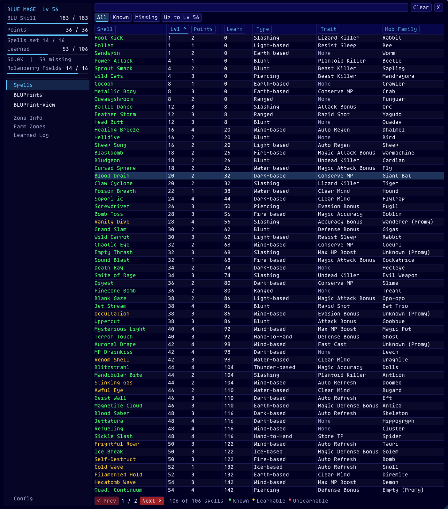
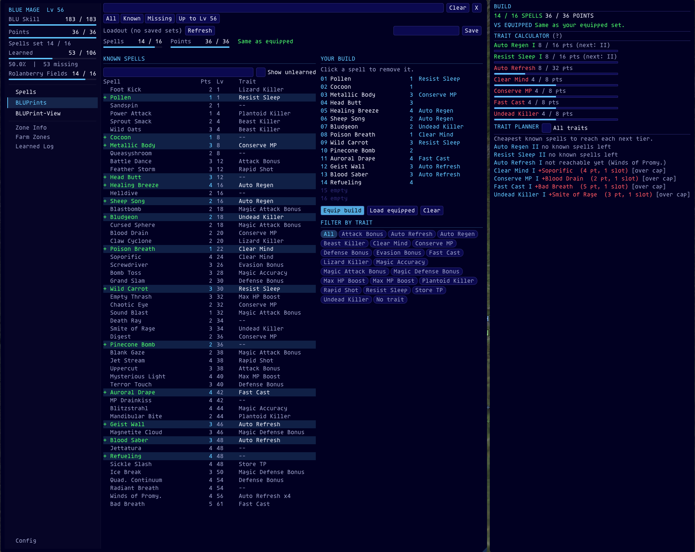

# Azure Codex

**Azure Codex** (formerly *BLUSpells*) is an Ashita v4 addon for **Blue Mage players on HorizonXI**. It brings spell tracking, learning locations, build planning, trait calculation and saved spell sets together in one in-game window.

All spell, trait, mob and zone data is tailored to **HorizonXI's level-75 era**. It is not a retail FFXI database.

**Version:** 1.19.0  
**Authors:** Izumi (ShiroIzumi) · Kyrias  
**Testing:** Demiora



---

## Contents

- [Features at a Glance](#features-at-a-glance)
- [Installation](#installation)
- [Commands](#commands)
- [Spell List](#spell-list)
- [Learning Locations](#learning-locations)
- [Zone Info](#zone-info)
- [Farm Zones](#farm-zones)
- [BLUPrints – Build Planner](#bluprints--build-planner)
- [Trait Calculator & Trait Planner](#trait-calculator--trait-planner)
- [BLUPrint-View & Azure Loadout](#bluprint-view--azure-loadout)
- [Target Tag](#target-tag)
- [Learned Log](#learned-log)
- [Themes & Configuration](#themes--configuration)
- [HorizonXI Rules Used](#horizonxi-rules-used)
- [Compatibility](#compatibility)
- [Credits](#credits)
- [Changelog](#changelog)

---

## Features at a Glance

| | |
|---|---|
| **Spell tracking** | All 106 HorizonXI Blue Magic spells, colored as Known, Learnable or Unlearnable based on your live Blue Magic skill. |
| **Search & filters** | Search every column at once; use `\|` to match any of several terms. Quick filters: All, Known, Missing, Up to my level. |
| **Learning locations** | Every zone and mob that teaches each spell, for HorizonXI-era zones only. |
| **Zone Info** | The spells you can learn in your current zone, and from which mobs. |
| **Farm Zones** | Zones ranked by how many spells you are still missing there. |
| **BLUPrints** | Plan a spell set within your real point and slot limits, then save it or equip it in game. |
| **Trait Calculator** | Trait tiers for a build, following HorizonXI's 75-era rules. |
| **Trait Planner** | The cheapest spells you know that reach each trait's next tier. |
| **Target Tag** | Shows "Teaches: …" when your target teaches a blue spell you are missing, and a green "Already Know: …" for spells you have learned. |
| **Learned Log** | A per-character history of every spell you learn: when, where, and from which mob. |
| **Themes** | Midnight, Abyss, Twilight, Golden, Garnet and Silver, all fully customizable. |
| **Mouse pointer** | A visible pointer over every Azure Codex window (FFXI hides the Windows one). Fuchsia and 1.4x by default; size, colors and shadow are adjustable. |

---

## Installation

1. Copy the `azurecodex` folder into your HorizonXI addons folder:
   ```
   C:\HorizonXI\HorizonXI\Game\addons\azurecodex\
   ```
2. Start HorizonXI through Ashita.
3. Load the addon:
   ```
   /addon load azurecodex
   ```
4. Open Azure Codex:
   ```
   /ac
   ```

The folder contains `azurecodex.lua` (loads everything), the `ac` folder (the addon's code, split by feature), `spells.lua`, `locations.lua`, a `BLUPrints` folder (saved builds) and `Screenshots`.

---

## Commands

| Command | Description |
|---|---|
| `/ac` · `/azurecodex` | Open or close the main window |
| `/ac config` | Open or close the Config window |
| `/acz` · `/azurecodexzone` | Open or close Zone Info |
| `/ac farm` | Open or close Farm Zones |
| `/ac log` | Open or close the Learned Log |
| `/bluspells` · `/bsp` · `/bsl` | Legacy aliases for the main window |
| `/bluspellszone` · `/bsz` | Legacy aliases for Zone Info |

---

## Spell List

The main window has a **sidebar** on the left and the spell list on the right.

- **Sidebar:** your Blue Magic skill, set points (and spells set), overall learned progress and the current zone's progress, each with a progress bar. Below them: **Spells**, **BLUPrints** and **BLUPrint-View**, then **Zone Info**, **Farm Zones**, **Learned Log**, and **Config** at the bottom.
- **Main area:** the search box, the filters and the current page. Below the list: Prev / Next paging, how many spells match, and the color legend.

The spell list shows every Blue Magic spell with its **Level, Points, Learn (skill needed), Type, Trait and Mob Family**.

- **Colors:** Known, Learnable (your current Blue Magic skill is high enough) and Unlearnable.
- **Sort:** click any column header; click again to reverse the order.
- **Search:** checks every column. Use `|` for OR searches, e.g. `refresh|regen|goblin` (hover the box for a reminder).
- **Filters:** **All**, **Known**, **Missing**, **Up to Lv N** (missing spells at or below your BLU level).
- **New spells:** a newly learned spell is selected and highlighted for a few seconds.

**Learn** is the minimum Blue Magic skill needed to learn the spell. On HorizonXI that is the A+ skill cap at the spell's level, minus 31.

---

## Learning Locations

Click a spell name to open its **Spell Locations** window. It lists every HorizonXI-era zone and mob that teaches the spell, with the spell's mob family in the header. Only the list scrolls, so the header and close button stay in place. On high-resolution screens you can switch to a hover tooltip instead (Config → Behavior).


---

## Zone Info

**Zone Info** (`/acz` or **Zone Info** in the sidebar) shows every spell you can learn in your current zone. Each entry shows the required Blue Magic skill, the spell level, your status (Known / Learnable / Unlearnable) and the mobs that teach it. Tick **Hide Known** to see only what is left. Only the list scrolls, so the header, Hide Known and the close button stay in place.

Zone Info and Spell Locations can be dragged from any empty spot, with or without the title bar. If a window won't move, check its lock in Config → Window.


---

## Farm Zones

**Farm Zones** (`/ac farm` or **Farm Zones** in the sidebar) ranks HorizonXI-era zones by how many spells you are still missing there. Zones with spells you can learn right now are listed first.

- Click a zone to expand it and see each missing spell with the mobs that teach it.
- **Learnable only** hides spells your Blue Magic skill can't learn yet.
- Your current zone is marked *(here)*.


---

## BLUPrints – Build Planner

Click **BLUPrints** in the sidebar to plan a spell set.

- **Top row:** the **Loadout** dropdown of your saved sets (asks before equipping) with Refresh, and on the right a build name box with **Save** (writes the set to the `BLUPrints` folder).
- **Budget bars:** spells and points used against your limits, plus how the build compares with your equipped set.
- **Known Spells (left):** click a spell to add it to the build; click it again to take it out. Search covers spells, traits and mob families, and **Show unlearned** lists spells you haven't learned yet (they can't be added). Spells that would go over your limits are dimmed.
- **Your Build (right):** the set slot by slot with points and traits; click a spell to remove it. Underneath: **Equip build**, **Load equipped** (loads the spells you have set right now) and **Clear**, then **Filter by Trait**: chips that filter Known Spells in one click (for example, only Auto Refresh spells, or spells with no trait).
- **Side panel:** totals, **VS Equipped** (what equipping would add or remove), the **Trait Calculator** and the **Trait Planner**. Its width follows the text, so nothing is cut off.
- **Spell set cooldown:** after you set new spells (from Azure Codex or the in-game menu), a tag like the "Teaches:" one shows "Spells ready in: Xs" and a bar. It only appears while spells are on cooldown. The server doesn't report this wait to the game's recast timers, so Azure Codex times it itself (60 seconds from when each new spell is set). Normal recasts after you cast a spell don't bring it up. It starts just under the Teaches tag and can be dragged anywhere. It also shows in the sidebar under Points.
- Limits follow your level: points and spell slots come from the live game value when available, otherwise from the HorizonXI level table (see [HorizonXI Rules Used](#horizonxi-rules-used)).



---

## Trait Calculator & Trait Planner

The **Trait Calculator** (BLUPrints side panel) shows each trait in the build with its current tier, its points toward the next tier, and a progress bar. Hover **(?)** for a summary of the rules.

The **Trait Planner** (side panel) lists the cheapest spells you know that would reach each trait's next tier. When those spells fit your limits, an **Add** button selects them for you. Tick **All traits** to plan traits that aren't in the build yet.

Spells that count extra toward their trait show the multiplier, e.g. *Auto Refresh x2*.

---

## BLUPrint-View & Azure Loadout

- **BLUPrint-View** (sidebar) opens a saved BLUPrint and shows its spells, points, traits and its difference from your current set. From there you can **Equip** it, **Import** it into BLUPrints, or **Delete** it (asks first).
- **Azure Loadout** (top of BLUPrints) is a quick dropdown of your saved sets. Choosing one asks for confirmation, then equips it.

---

## Target Tag

While Blue Mage is your main job, a small tag appears whenever your current target teaches a blue spell in this zone:

- **"Teaches:"** lists the spells you are still missing, in your Learnable or Unlearnable color.
- **"Already Know:"** lists the spells you have already learned, on a green background. If the mob only teaches spells you know, the whole tag turns green.
- Once the targeted mob has **actually used** a spell you are missing, it reads **"Teaches: *spell* and has been used!"**. It never changes while the mob is only readying the move. The list resets when you change zones.

- Drag the tag anywhere you like.
- Lock it, or turn it off, in Config → Behavior.
- It only reads your target, the addon's own location data and the mob's finished moves.

---

## Learned Log

The **Learned Log** (`/ac log` or **Learned Log** in the sidebar) records every spell you learn from now on: the date and time, the zone, and the mob you defeated. It is saved separately for each character and can be cleared from the window.

---

## Themes & Configuration

Open **Config** from the bottom of the sidebar or with `/ac config`.

| Tab | Options |
|---|---|
| **Window** | Lock each window, title bar, border, window color and opacity, reset position, **mouse pointer** (on / off, size, color, outline, shadow) |
| **Font & Colors** | **Theme**, font scale, and colors for Known / Learnable / Unlearnable, Header / Accent and the paging buttons |
| **Display** | Compact or normal rows, automatic or fixed rows per page, visible columns |
| **Behavior** | Remember search / filter / sort, highlight new spells, click or hover for locations, **Assimilation merits**, **Target Tag**, reset all settings |
| **About** | Version and credits |

**Themes:** Midnight (default) · Abyss · Twilight · Golden · Garnet · Silver. Picking a theme sets the window surfaces, the window color and the accent color. You can still adjust any of them afterwards. In Garnet, trait names in Your Build and the Trait Planner are sand-colored and unreached traits are amber, so they stand apart from the red accent.


**Mouse pointer:** FFXI hides the Windows mouse pointer, so Azure Codex draws its own while the mouse is over any of its windows, dropdowns or popups. By default it is a bright fuchsia arrow at 1.4x size. Turn it off in Config → Window if you already use a pointer tool such as YoloMouse.

Search boxes are skipped by the Tab key, so pressing Tab in game to target never jumps into Azure Codex. Click a box to type in it.

---

## HorizonXI Rules Used

**Blue Magic set limits by level** (the live game value is used when the client provides it):

| Level | Blue Magic Points | Spells |
|---|---|---|
| 1–10 | 10 | 6 |
| 11–20 | 15 | 8 |
| 21–30 | 20 | 10 |
| 31–40 | 25 | 12 |
| 41–50 | 30 | 14 |
| 51–60 | 35 | 16 |
| 61–70 | 40 | 18 |
| 71–75 | 45 (+ Assimilation merits) | 20 |

**Traits** (HorizonXI / LandSandBoat 75-era rules):

- Each set spell gives **4 trait points** to its trait. The in-game description shows this as e.g. "Job Trait: Auto Refresh (4)".
- Most traits gain a tier every **8 points**.
- **Auto Refresh**, **Auto Regen** and **Conserve MP** stop at **Tier I** (8 points), the ToAU-era cap. **Resist Gravity** tiers are 8 / 12 / 16.
- Spells that count extra: Self-Destruct, Frightful Roar, Light of Penance **x2** · Voracious Trunk **x3** · Actinic Burst, Plasma Charge, Winds of Promyvion **x4**.
- Each trait has its own maximum tier.

---

## Compatibility

- **Ashita v4** on **HorizonXI**.
- Equipping uses Ashita's `blusets` helper when it is installed, and a built-in fallback otherwise.
- Data is HorizonXI-specific (level-75 era) and is not meant for retail FFXI.

---

## Credits

- **Izumi (ShiroIzumi)**: original BLUSpells / Azure Codex development
- **Kyrias**: collaboration, BLUPrints, spell-set / build functionality, data development
- **Demiora**: testing

Azure Codex continues the original BLUSpells project under its new collaborative name.

---

## Changelog

### 1.19.0
- Target Tag: **"Teaches: *spell* and has been used!"** once the targeted mob has actually used that spell (finished moves only, never on "readies").
- Auto Regen capped at Tier I (8 points), like Auto Refresh and Conserve MP.
- Code cleanup: the single 5,800-line `azurecodex.lua` is now split by feature into the `ac` folder (core, pointer, theme, data, spell table, config, BLUPrints, zones, target tag, pages, set cooldown, main window, events). This also removes LuaJIT's 200-local limit problem.

### 1.18.2
- Tab visibility options; Auto Refresh and Conserve MP capped at Tier I (Kyrias).

### 1.18.0
- Visible **mouse pointer** over every Azure Codex window, dropdown and popup (FFXI hides the Windows one). Default: fuchsia, 1.4x. Size, fill color, outline, shadow and on / off in Config → Window.

### 1.17.0
- Target Tag now shows on every mob that teaches a blue spell. Spells you already know are listed as "Already Know:" on green; if you know everything that mob teaches, the whole tag is green.

### 1.16.1
- The spell set cooldown tag only appears for the 60-second wait after setting new spells, not when you cast a Blue Magic spell. It shows just the time and the bar (no spell names).

### 1.16.0
- Spell set cooldown now actually shows: it times the wait after setting new spells itself (the server doesn't report it to the game's recast timers), and it looks like the "Teaches:" tag, listing the spells still waiting.

### 1.15.0
- Spell set cooldown bar: after changing your Blue Magic set, shows the time until the set spells can be cast (floating bar plus a line in the sidebar).

### 1.14.2
- Trait Calculator back in the BLUPrints side panel (which still sizes to its text).
- Trait chips moved under Your Build as **Filter by Trait**.

### 1.14.1
- Trait Calculator moved under Your Build in the main window.
- The BLUPrints side panel sizes its width to the Trait Planner text instead of cutting it off.

### 1.14.0
- BLUPrints redesigned: Loadout and Save on one row, budget bars, **Known Spells** on the left (click to add, trait chips to filter, search, Show unlearned) and **Your Build** on the right (click to remove) with Equip build / Load equipped / Clear.
- The side panel now holds the totals, VS Equipped, Trait Calculator and Trait Planner.

### 1.13.3
- Zone Info and Spell Locations: only the list scrolls now (like Farm Zones), so the header and close button stay in place.
- Their lists no longer use ImGui tables (measured columns instead), the same as the windows that already drag fine.

### 1.13.2
- Zone Info and Spell Locations can be dragged from any empty spot, with or without the title bar.
- Spell Locations header: spell name and mob family on the left, close button on the right (no overlap).
- Spell list columns: Lvl, Points and Learn (was "Learn Skill") are narrow fixed columns; Spell, Type, Trait and Mob Family share the rest equally.
- Garnet theme: trait names on the Spell Card / Trait Planner use a sand color and unreached traits / over-limit picks use amber, so they no longer blend into the red accent. Other themes are unchanged.

### 1.13.1
- Fixed: 1.13.0 failed to load on newer Ashita builds (error in BeginChild).

### 1.13.0
- New main-window layout: a sidebar with progress bars (Blue Magic skill, set points and spells, learned, current zone) and the navigation (Spells, BLUPrints, BLUPrint-View, Zone Info, Farm Zones, Learned Log, Config). The search box, filters and spell list fill the right side.
- The whole main window follows the font scale, not just the table.
- Pager and color legend tidied up; the close button (title bar hidden) sits at the end of the search row.

### 1.12.3
- Zone Info can be dragged by its header, even with the title bar hidden.
- Zone Info header no longer overlaps: name, zone ID and progress on the left, Hide Known and the close button on the right, at any font scale.
- Zone Info level / status columns size to the font scale.

### 1.12.2
- Pressing Tab in game no longer focuses the Azure Codex search box.

### 1.12.1
- New themes: Golden, Garnet and Silver.
- Farm Zones and the Learned Log keep their header and close button in place while the list scrolls.

### 1.12.0
- **Trait Calculator fixed** (it never counted anything) and rebuilt on HorizonXI 75-era rules, in both BLUPrints and BLUPrint-View.
- **Point and slot limits follow your level** (they were fixed at 50 / 20), with an Assimilation merit setting. Builds over the limit are kept but can't be equipped.
- BLU Points shows your equipped total against the level limit when the client doesn't report live points.
- Clicking a filter while on BLUPrint-View returns to the spell list.
- Azure Loadout asks before equipping.
- Performance: the BLUPrints folder is no longer read every frame, the spell list and zone progress are cached, and the equipped-set memory lookup runs once.
- New: Trait Planner, VS Equipped, Farm Zones, Target Tag, Learned Log, Theme dropdown.
- Version number fixed.

### 1.11 and earlier
- Restyled to a flat look with tabs and accent underlines; default midnight blue background (`#010022`).
- BLUPrints, Azure Loadout, Zone Info, spell locations, filters, search and config windows.
