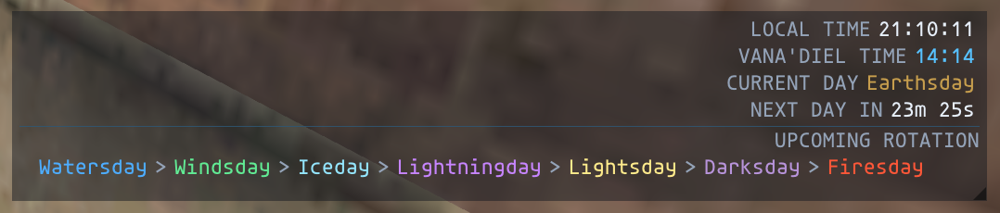
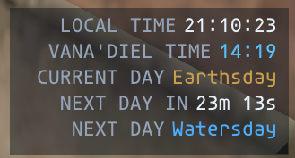

# IzClock

**Version:** 3.1.4\
**Platform:** Ashita v4 / HorizonXI\
**Author:** Izumi (ShiroIzumi)

IzClock is a small, fully configurable Vana'diel clock for Final Fantasy
XI. It works out Vana'diel time from your computer's clock and can show
the current elemental day (and the next one), the countdown to the next
day, the moon phase, your local time and Japan time. You choose which
pieces show, their order, their labels and their colors.

Hover over the clock for the week, the moon, crafting, guild hours and
ships. Click it for an info window with all of that in one place. You
can also turn on a second clock and a day-change alert.

## Screenshots

The screenshots below show IzClock 2.x. The 3.0 one-line, stacked and
full layouts look much the same, with more control over each part.





## Commands

| Command | What it does |
| --- | --- |
| `/ic` or `/izclock` | Show / hide the clock |
| `/ic config` | Open the settings (also `/icconfig`, or right-click the clock) |
| `/ic info` | Open / close the info window (or click the clock) |
| `/ic second` | Show / hide the second clock |
| `/ic lock` | Lock / unlock both clocks' positions |
| `/ic reset` | Move both clocks back to the top-left corner (and the info window under the clock) |
| `/ic help` | List the commands in the chat log |

`/ic show` and `/ic hide` also work.

## The clock

- **Drag** the clock anywhere, unless it's locked.
- **Click** it, without dragging, to open the info window.
- **Right-click** it to open the settings.
- **Hover** over it to open the hover window. You can set it to open over the whole clock or over the day only, or turn it off.

The clock hides on the character select screen. By default it also
hides during cutscenes and while the game's interface is hidden, but
not while game menus are open.

### Pieces

| Piece | Example |
| --- | --- |
| Local time | `LOCAL 12:10:57` |
| Vana'diel time | `VANA 05:33` |
| Japan time (UTC+9) | `JP 01:10:57` |
| Elemental day | `Watersday > Windsday` |
| Next day in | `NEXT 44m 15s` |
| Moon | `MOON Full Moon (100%)` |

Each piece can be turned on or off, moved up or down, and given its own
label. An empty label shows the value alone.

### Layouts

- **One line**: everything on a single line, with a separator you choose between the pieces.
- **Stacked**: one piece per line, with the labels in a column.
- **Full**: stacked, plus the rest of the week's days.

## Hover window and info window

| Section | What it shows |
| --- | --- |
| This week | The coming days, how long until each one starts, and the local time it starts at |
| Moon | Phase, %, waxing or waning, and when the next Full Moon and New Moon start |
| Crafting | The crystal element favored today, the element it is strong against, and which guilds are on holiday |
| Guild hours | Each crafting guild: open or closed, its hours, and when that changes |
| Ships & airships | The Jeuno airships, the Selbina / Mhaura ferry, the Bibiki Bay manaclipper and the Carpenters' Landing barge: boarding now, or when each leaves and docks |

You choose which sections the hover window shows, and which ships it
lists. The info window always shows everything, in three columns, with
a large Vana'diel time and day at the top. It opens where you last left it
(`/ic reset` puts it back under the clock).

Guild hours, guild holidays and ship times are LandSandBoat's, the
server HorizonXI is built on. The ship times there were measured from
retail. The crafting-day bonus is traditional FFXI crafting lore;
LandSandBoat does not apply one, so treat it as a guide.

## Second clock

Off by default; turn it on with `/ic second` or on the Window page. It
has its own pieces, layout, formats, look and position. A switch at the
top of the Clock, Format and Look pages picks which clock you are
editing. One use is a one-line bar for everyday play plus a stacked
panel elsewhere.

## Day-change alert

Off by default. When it's on, IzClock writes a line in the chat log
and/or flashes the clock in the new day's color. You choose when it
fires (as the day changes, or up to 30 minutes before), how long the
flash lasts, and which days it fires for. The Alerts page has a Test
button.

## Settings

The settings window has a sidebar with these pages. Drag its
bottom-right corner to resize it; it opens again where you left it, at
the same size.

- **Clock**: the layout; which pieces show and in what order, with their labels; whether labels show; the next day after the current one; element tags (`[Wa] Watersday`).
- **Format**: 12- or 24-hour time; seconds; the countdown style (`44m 15s` or `44:15`); the moon illumination %; the separator text.
- **Look**: text size and effect (none, shadow, outline or both); colors for labels, values, Vana'diel time, separators and each of the 8 days; the background color and opacity (0 is see-through); border and border color; rounding; padding; spacing; a width that fits the text or a fixed width with left / center / right alignment.
- **Hover & info**: where the hover window opens, its text size, its sections and ships, the info window's text size, and a button that opens the info window.
- **Alerts**: the day-change alert.
- **Window**: the second clock; lock and reset each clock; hide during cutscenes; the settings window's theme (the info window uses it too), text size and a reset for its size and position; the info window's text size; the mouse pointer.
- **Commands**: the commands above.

Settings are saved per character, shortly after each change.

Settings from IzClock 2.x carry over on the first load. Compact mode
becomes the one-line layout, mini becomes stacked, full stays full, and
your shown pieces, colors, opacity, lock and position are kept.

## How Vana'diel time is calculated

IzClock does not need packet `0x5C`. It uses the fixed relationship
between Earth time and Vana'diel time:

``` text
1 Vana'diel day    = 3456 Earth seconds
1 Vana'diel hour   = 144 Earth seconds
1 Vana'diel minute = 2.4 Earth seconds
```

It adds an epoch offset to Unix time and works out the hour, minute,
elemental day (an 8-day week) and the time left until the next day.
Because it doesn't wait for a packet, the clock shows right away.

The moon follows the standard 84-day FFXI cycle: New Moon, Waxing
Crescent, First Quarter, Waxing Gibbous, Full Moon, Waning Gibbous,
Last Quarter and Waning Crescent, plus the illumination %.

Local time uses your computer's time zone, including daylight saving.
Japan time is always UTC+9.

## What it cannot do

IzClock does not:

- change or sync server time
- forecast weather
- read anything from the game (guild hours and ships are worked out from the clock)
- correct a wrong system clock (a wrong system clock means a wrong Vana'diel time)
- follow a private server that changes FFXI's standard time or moon rules

## Files

| File | Purpose |
| --- | --- |
| `izclock.lua` | Settings, commands, events |
| `core/vana.lua` | Vana'diel time, days, moon |
| `core/theme.lua` | The settings window's look |
| `core/cursor.lua` | The mouse pointer over IzClock windows |
| `core/gamestate.lua` | Hiding before login and during cutscenes |
| `core/schedule.lua` | Guild hours, ships, moon forecast, crafting element |
| `ui/clock.lua` | A clock window (main and second) |
| `ui/info.lua` | The hover window and the info window |
| `ui/config.lua` | The settings window |
