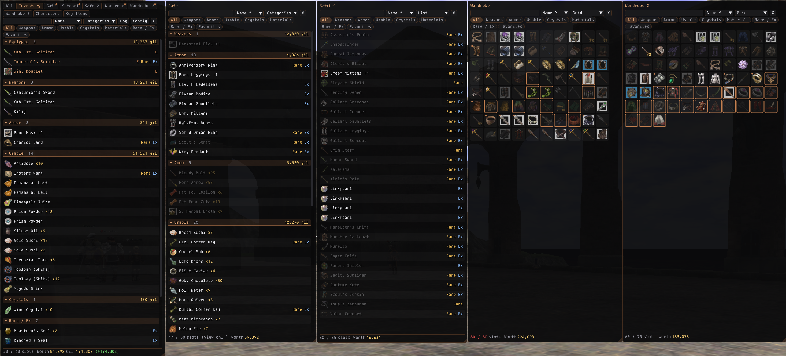
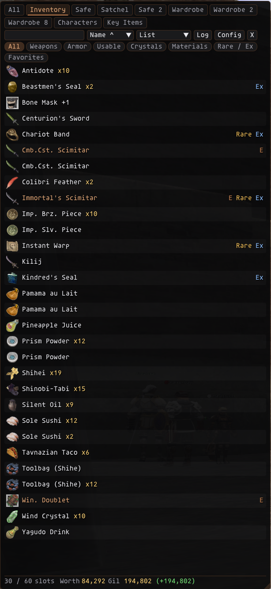
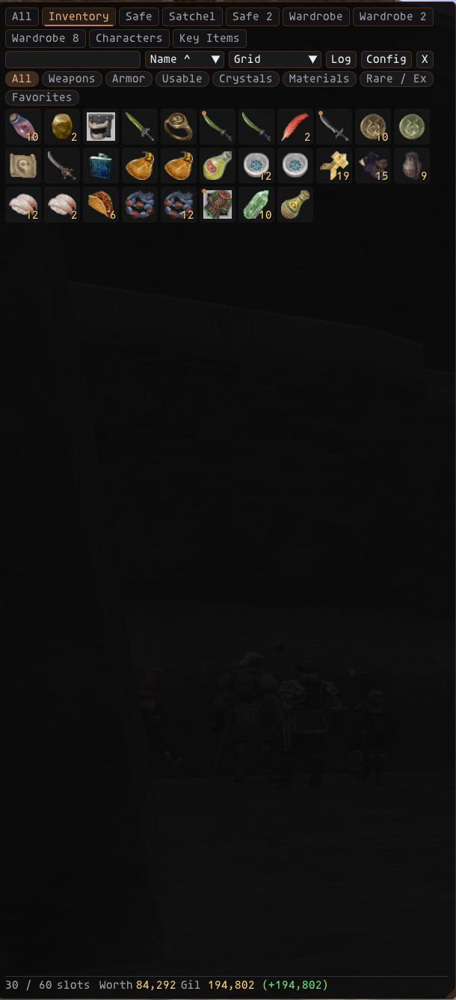
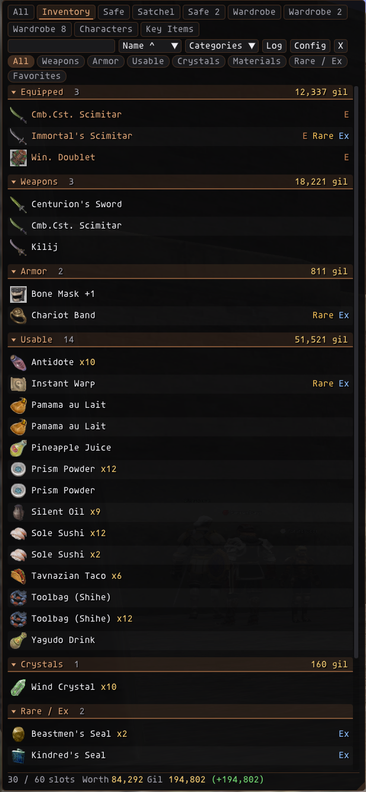

# NAInv (New Age Inventory)

**NAInv** is an Ashita v4 addon for **HorizonXI** that replaces the 10-line inventory list with a modern, configurable window: every bag in tabs, game icons, the quantity right beside the name, list, grid or categories view, item values, favorites, search, sorting, filters, item tooltips, a right-click menu, a session loot log, your other characters' bags and your key items.

**Version:** 1.3.5  
**Author:** Izumi (ShiroIzumi)

*Inventory with Safe, Satchel and two Wardrobes popped out (Shift+Click a tab), each with its own view: Categories, List and Grid.*

---

## Installation

1. Copy the `nainv` folder into `C:\HorizonXI\HorizonXI\Game\addons\`.
2. In game: `/addon load nainv`
3. Press **I** (default open key) or type `/nai`.
4. *(Optional, for item values)* Download **`sql/item_basic.sql`** from the [LandSandBoat GitHub](https://github.com/LandSandBoat/server/blob/base/sql/item_basic.sql) (use the **Raw** / download button) and put it in the `nainv` folder next to `nainv.lua`. Then press **Reload price list** in `/nai config` > **Value**, or reload the addon.

## Commands

| Command | Description |
|---|---|
| `/nai` | Open or close the inventory window and your pop-outs |
| `/nai config` | Open or close the config window |
| `/nai help` | List commands and your current open key |

## The window

- **Bag tabs:** All, Inventory, and every other bag your character has (Satchel, Sack, Case, Wardrobe, and Mog House storage like Safe / Storage / Locker as *view only*). Bags you don't have are not shown. **All** lists everything with the bag name on each row.
- **Pop-out windows:** **Shift+Click** any tab (a bag, All, Characters or Key Items) to open it in its own window. Each one keeps its own size, position, view, sort, filter and search, and they're remembered across reloads. Close one with its **X**, or **Shift+Click** its tab again.
- **Open key / `/nai`:** hides every window that's showing, or shows the main window plus every pop-out you didn't close with X.
- **Characters tab:** the last known bags of every character you've logged in with NAInv loaded, with the character and bag on each row (view only). Handy for "which mule has my Beehive Chips?".
- **Key Items tab:** every key item you have, searchable. Temporary ones get an orange **TEMP** tag. Chips filter **All / Permanent / Temporary / Maps & Other**. Right-click a key item to mark it temporary or permanent if the built-in list gets it wrong.
- **List view (default):** icon, item name, then the quantity (`x12`, or `12/99` if you pick the stack format) right after the name. Tags on the right show **E** (equipped), **Rare**, **Ex** and **Split**.
- **Grid view:** a Bagnon-style icon grid with the quantity in the corner.
- **Categories view** (AdiBags style): items grouped into Favorites, New, Equipped, Weapons, Armor, Ammo, Usable, Crystals, Rare / Ex and Materials. Each section header shows the item count and its sell value; click a header to collapse it. Sections can show as a list or a grid, and you set their order in Config.
- Switch views with the **List / Grid / Categories** menu in the toolbar.

<table>
  <tr>
    <th>List</th>
    <th>Grid</th>
    <th>Categories</th>
  </tr>
  <tr>
    <td></td>
    <td></td>
    <td></td>
  </tr>
</table>

- **Search** item names, **sort** by Slot, Name, Type, Qty or Newest (pick the same sort again to reverse), and **filter** with the chips: All, Weapons, Armor, Usable, Crystals, Materials, Rare / Ex, Favorites.
- **Tooltip:** hover an item for its description, equip slots, level and jobs, stack size, split stacks, **sell value**, and where it is.
- **Favorites:** right-click > Add to favorites. They get a gold star, sit at the top of List / Grid (optional), have their own section and filter, and **can't be dropped** until you remove them.
- **Gear you can't wear** on your current job / level is greyed out (optional).
- **Split stacks:** partial stacks of the same item in one bag get a **Split** tag (a blue corner in the grid) so you know they can be merged.
- **New items** stay highlighted until you hover them or close the window (or glow for a set time, in Config). Zoning does not count as new.
- **Footer:** slots used (red when full), the sell value of what's shown, your gil and how much you gained or spent this session.
- **Inventory full warning:** a banner at the top of the screen for a few seconds when an item comes in and you're at or under your free-slot limit (5 by default).

## Item values

- NAInv shows what an NPC vendor pays for each item, per item and for the stack.
- **Price list:** LandSandBoat's `item_basic.sql` (see Installation). Items that can't be sold to NPCs say so.
- **Learned prices:** whenever a shop appraises an item (you pick it to sell), NAInv saves the exact price HorizonXI gave you. Learned prices replace the list price and are marked **[vendor]** in the tooltip. They're shared by all your characters.
- Fame does not change NPC sell prices, so one price per item is the true value.
- For stackable items the tooltip also shows what a **full stack** sells for, even if you only have one, so you can see whether buying a stack on the AH and vendoring it would make or lose gil.
- **Auction House category:** the tooltip shows where the item is listed, e.g. `AH: Materials > Alchemy`, or *Not sold on the Auction House* (from the same `item_basic.sql`; turn it off in Config > Value).

## Loot log (Log button)

- Session time, gil gained or spent, gil per hour, and today's gil change.
- Every item you gained this session (drops, trades, purchases, crafts) with the time, quantity and value, plus the total value.
- Moving items between your bags, or taking them out of Mog House storage, does not count.
- **Clear log** empties the list; **New session** also restarts the timer and gil.

## Mog House snapshots

Safe, Storage and Locker are only loaded by the game in your Mog House. NAInv saves what was in them the last time they loaded and keeps showing that anywhere, marked **(snapshot)** with the time it was saved (hover the footer).

## Right-click menu

- **Add to / Remove from favorites** for any item.
- **Use** for usable items in your inventory (sends `/item "Name" <me>`).
- **Equip** for gear in your inventory or wardrobe (sends `/equip slot "Name"`). Rings and earrings let you pick the slot.
- **Drop...** for items in your inventory that aren't equipped or favorites. Opens a small dialog with a quantity slider for stacks. **Rare / Ex** items need a second red click to confirm. Drop sends the same packet the game's own Drop sends.

Nothing happens unless you click it. Other characters' items and Mog House snapshots are view only.

## Config (`/nai config`)

| Tab | Options |
|---|---|
| **Look** | Theme (Copper default, Black, Garnet, Silver, Emerald, Amethyst), window color and opacity, lock, title bar, reset position, list / grid / categories, size (scales text, icons and rows), list icon size, grid cell size, row spacing, E / Rare / Ex tags, quantity format (`x12` or `12/99`), grey out unusable gear, pin favorites, split stack marker, inventory full warning and its free-slot limit (with a Test button), new-item highlight (until hovered / window closed, or for a set time) |
| **Text** | Text effect (None, Shadow, Outline, Outline + Shadow, Glow), effect color and opacity, item name color, quantity / gil color, show x1 on single items, live preview |
| **Value** | Show sell values, show AH category, price list status and Reload, learned price count, Forget learned prices (click twice) |
| **Categories** | Sections as list or grid, section order (up / down), Reset order, Expand all sections |
| **Keybind** | Turn the open key on / off, pick the key (click and press any key), Ctrl / Alt / Shift. The key is ignored while the chat box is open or you're typing in a text box. |
| **Bags** | Show or hide each bag's tab |
| **About** | Version and commands |

Settings are saved per character. Learned prices and every character's bags are shared, in `addons\nainv\data\`.

## Notes

- Mog House storage shows what the game last loaded for it; it can be viewed but not used from NAInv.
- Text effects are drawn as a few extra text passes, so they cost almost nothing.

## Changelog

### 1.3.5
- New items stay highlighted until you hover them with the mouse or close the window (Config > New items > *Keep highlighted until I hover the item or close the window*, on by default). Turn it off to get the timed highlight back.

### 1.3.4
- Key Items: temporary key items get the **TEMP** tag automatically, from a built-in list of key item IDs (permanent key items and job gestures are known; maps, claim slips, Voidwatch and Abyssea items are never tagged; everything else is temporary).
- Right-click still overrides it per key item, in either direction. Right-click again to go back to the default. Your marks from 1.3.3 still count.
- Chips on the Key Items tab: All, Permanent, Temporary, Maps & Other.

### 1.3.3
- Key Items: right-click a key item to mark it as temporary; it gets a **TEMP** tag on the right. Right-click again to unmark. The game doesn't tell addons which key items are temporary, so you mark them once. Marks are shared by all your characters (`data\key_items_temp.lua`).

### 1.3.2
- Key Items tab works: it reads the game's own key item list (permanent and temporary key items), which the server sends when you log in or zone, and remembers it per character. If it's empty, zone once.
- Wardrobe 5 to 8 are supported (Wardrobe 8 shows if you have it).
- Tab order: All, Inventory, Safe, Satchel, Safe 2, Wardrobe, Wardrobe 2-8, then Storage, Locker, Sack, Case, Characters, Key Items.

### 1.3.1
- Pop-out windows remember their size, position and view after you close them, and reopen the same way.
- Tabs that are open in their own window get a small window mark in the corner.
- The footer shows gil (and this session's change) only on the Inventory tab. Item value is labeled "Worth" so the two numbers can't be confused.

### 1.3.0
- Tooltip: full stack sell price, and the item's Auction House category.

### 1.2.3
- Fix: the open key could randomly stop working until a reload (Ctrl / Alt / Shift got stuck, e.g. after Alt+Tab). It now reads them from Windows.

### 1.2.2
- Shift+Click a tab whose window is already open to close it.

### 1.2.1
- Price list: reads the current LandSandBoat `item_basic.sql` layout (it showed "Loaded 0 prices").

### 1.2.0
- Shift+Click any tab to open it in its own window, with its own size, position, view, sort, filter and search.
- The open key and `/nai` hide / show every window you didn't close with X.

### 1.1.0
- Item values: LandSandBoat price list plus exact prices learned from vendor appraisals. Shown in tooltips, the footer, category headers and the loot log.
- Categories view (AdiBags style), each section as a list or grid, collapsible, in your order.
- Favorites: star, pinned to the top, own filter and section, can't be dropped.
- Gear your job / level can't wear is greyed out.
- Quantity as `x12` or `12/99`; split stacks are marked.
- Inventory full warning banner.
- Session loot log with gil tracker (session, per hour, today).
- Characters tab: your other characters' bags.
- Mog House storage snapshots, viewable anywhere.
- Key Items tab.

### 1.0.0
- First release.
